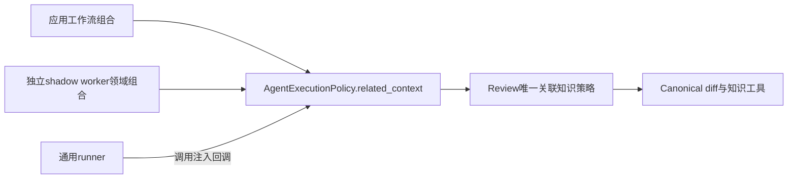

# 关联知识策略归属修复（框架后切片）

当前Copilot wheel `1448d7b98e6dd92df9d8922530c1190c65a3035821588b6c63e9e3043dcf7aea`，Bot3bbf不变。框架交付保持封存；原26bd安装补证及e3eb完整整合保留原身份。

## 所有者、迁移和删除

此前通用agent runner直接导入review.planner，识别pr_diff并决定关联知识。该业务选择现由`review/context_policy.py:related_knowledge_briefing`唯一拥有。原runner主体已删除，只调用可选`AgentExecutionPolicy.related_context`；不再导入review或识别pr_diff／doc_related／review_knowledge_context。

应用`app/agent_context.py`为复制的注册表绑定默认策略，`WorkflowExecution`在improvement领域包装外层组合。因此普通步骤和领域提前接管的review步骤都会获得策略。调用方自定义回调优先，不修改共享注册表或传入context。shadow策略在领域工厂中保留原base回调并应用相同review策略，覆盖直接构造context的独立shadow worker；scope、技能计数、repo map约束不放宽。新字段追加在dataclass末尾，保留旧位置参数顺序。

旧的知识包查询、模型上下文原样渲染、legacy不可信包装／转义、trace事件、ablation、rename两侧路径选择均保留。裸执行内核不再自动选择review业务策略；内部直接调用者需要显式组合。SDK／CLI／MCP通过应用工作流获得相同默认行为。这里不宣称全部engine下的注册领域步骤都不导入领域模块，也不将检索工具适配器误称为纯内核。

## 验证及明确失败

源码定向212项通过：实际应用→runner提示、普通／shadow隔离、自定义回调、领域提前接管、legacy／adaptive知识工具、ensemble、planner和依赖边界。正常安装精确wheel后，122项行为／SDK Direct／Strict检查及Bot117项通过。模型／GitHub边界均受控，真实新模型调用0；不是当前完整双仓或新Docker／真实质量验收。

原安装选择不是全绿：一项`test_intra_knowledge_anchor_links_resolve`失败，六条链接指向wheel外源码仓库的贡献文档。相同测试在未改26bd也失败且六条一致；当前源码模式通过。保留原XML／日志和driver exit1，单独assessment.json明确范围，将打包／贡献文档链接缺口登记P2；没有跳过、修改测试或回写原报告。安装依赖复用旧环境，不宣称fresh最小消费者。

初次新增rename测试错误地只期望新路径，实际原策略保留旧／新两侧，已修正测试期望。一次组合选择了不存在的测试文件，收集前拒绝；原失败保留，按实际测试文件重跑通过。

## 交付与后续

代码增量相对26bd：六个生产文件，+47行／+236 AST节点；两处新所有者／组合模块，旧runner主体删除。Bot未改，总行数减少不是门槛。`agent-related-context-boundary-20261017`包含精确wheel、相对26bd源码增量、before／after、重建与用量／AST证据、安装及源码原始结果。

P1真实Direct／各knowledge质量、深层恢复／原unknown对账保留。P2文档链接打包、精细预算／served model／认证及其他后端矩阵保留；最终配对集成、release／pin和部署验收继续开放。未重放旧执行，未commit／push／发布／部署，完整目标不标记完成。
