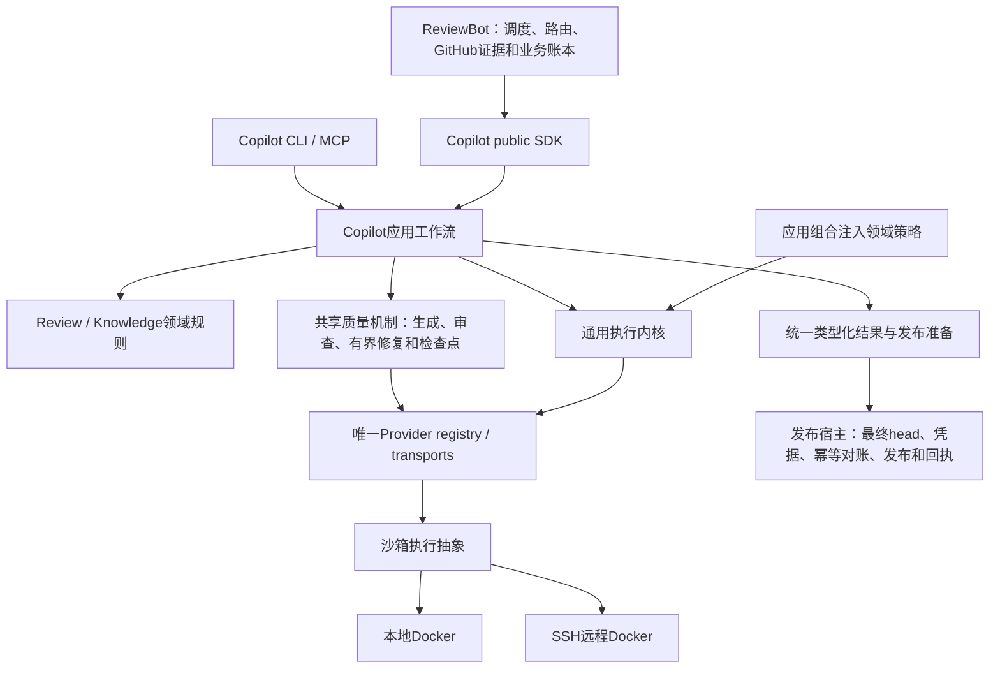

# 框架阶段收口交付 · 2026-10-17

> 本页保留框架冻结交付（1b36／2db4）的范围；后续宿主修复及当前1b36／24ac配对的状态，以[当前验收核对](single-capability-current-acceptance-audit-20261017.md)为准。

框架阶段已交付，当前没有登记的未接通框架连接。当前修复的必要验证完成；停止扩展本阶段实现。完整重构目标保留，真实模型质量、深层恢复、其他后端及最终发布分阶段验收，不再阻挡框架交付。本页为框架阶段冻结交付入口；后续报告保留各自版本范围。

## 架构与唯一归属

SDK／CLI／MCP进入同一应用层。沙箱机制与执行位置分离，本地／远程使用同一工作流。Bot jobs和发布回执、Copilot runs、knowledge生命周期、领域预算分别保留权威；重复边界校验调用相同规则。

## 能力归属、调用方迁移与旧实现删除

| 唯一owner | 已迁移调用方 | 删除主体及保留边界 |
| --- | --- | --- |
| Copilot providers | review、knowledge、triage、owner routing | 删除Bot vendor调用和解析主体；Bot保留路由／fallback业务政策。 |
| Copilot ReviewRuntime / RunService | Direct／Strict、local／remote、SDK／CLI／MCP | 删除Bot Direct执行／repair主体；兼容接口只转换和委托，保留strict_run_id，通用身份使用provider_run_id。 |
| Copilot review规则／发布准备 | findings、dispositions、candidate、diff、Bot及standalone | 合并重复recheck、diff及候选校验和发布资格；head漂移拒绝发布。最终head读取及GitHub副作用留在宿主。 |
| Copilot knowledge / Curator | intake、curation、lifecycle、validators、History、Harvest | 删除Bot知识模型／curation循环及重复证据物化主体；保留append-only字节与lifecycle渲染合同。 |
| Copilot共享质量机制 | 各init步骤、Discovery、depth、maintenance、curation | 派发／有界修复／检查点／unknown处理共用；各步骤schema、rubric和验收政策保留。机制相同不代表审查内容相同。 |
| Copilot进程监督／应用组合 | providers、validators、辅助进程、workers | 通用内核不导入领域业务，由应用注入；Docker执行不复制业务循环。 |
| ReviewBot宿主 | polling、assignment、admission、业务重试、Git事务、publication | 只经public SDK调用共享能力；保留GitHub业务状态、业务账本、凭据和回执。 |

[逐项机器清单](single-capability-framework-inventory.json)：70项能力、41项旧主体删除记录、24项已闭环连接、0项登记的未闭环框架连接。每项列出owner／callers，删除项列出路径和主体；删除记录不等同文件数，也不以净减行作为门槛。清单中的历史证据保留原范围，当前状态以framework_closeout和current_review_bundle为准。

## 可审阅、可运行的代码

- 当前完整双仓补丁、配对wheels及证据包 (host-local path: `/data/zhoutaichang/copilot/output/single-capability-completion-20261012/rollback-admission-20261017T112850Z/rollback-admission-review.tar.gz`)，SHA256 `84f039771d0e9e81da98f531032db020ed4caee1b370fee6ab7e9ac6dae2c475`。
- 代码身份及补丁重建证明 (host-local path: `/data/zhoutaichang/copilot/output/single-capability-completion-20261012/rollback-admission-20261017T112850Z/code-identity.json`)。完整patch分别对Copilot `647e6e02`／ReviewBot `1e70e983`应用一次，不能叠加旧overlay。
- [精确配对安装与运行验证](single-capability-current-pair-integration-20261017.md)包含fresh最小安装、公开SDK consumer探针和安装主流程；[本地／SSH Docker控制](single-capability-1b36-runtime-controls-20261017.md)绑定同一产品版本。
- 工作树：Copilot (host-local path: `/data/zhoutaichang/copilot/wt-copilot-single-capability-20261012`)／ReviewBot (host-local path: `/data/zhoutaichang/copilot/wt-reviewbot-single-capability-20261012`)。包内为可重建完整代码，包含此前保留工作。

当前wheel SHA256：Copilot `1b36ed44ab9fc649ec364aa51c0747f25aeda4e9c07cf024366db721910309a9`；ReviewBot `2db4f086ebc5549ff9ad4c11e6d9402679f7524e0171c8dee775d69fe21d8175`。最新变化为Bot部署宿主资源，不改变这两份wheel。

## 主流程与必要验证结果

入口→SDK→应用工作流→provider→类型化结果→发布准备已贯通，覆盖Direct／Strict、local／remote、carried findings、stale-head拒绝和原身份防重复派发。public-SDK-only、领域不依赖SDK／transport、执行内核不依赖领域的边界检查通过。模型／GitHub主流程响应受控，不据此宣称真实质量或真实发布通过。

| 验证范围 | 当前结果和实际限制 |
| --- | --- |
| 精确配对源码整合 | Copilot 6008项、失败／错误0；原4项环境skip保留，并有相同用例的当前安装／真实namespace补证。原配对Bot 2862项通过。 |
| 安装主流程 | Copilot 154项、Bot 205项通过，移出源码目录以-I运行；fresh最小依赖安装及公开release SDK探针通过。 |
| 本地／远程沙箱 | 同一执行抽象下实际Docker stdio、取消、idle／absolute deadline、进程树清理、原receipt对账和防重复派发通过；无模型调用。 |
| 最后宿主修复 | 当前Bot完整套件2881项、受影响109项通过，无skip；确认恢复journal错误／缺失、启动失败时拒绝伪成功并保留原环境证据。服务边界由fixture控制，未操作生产systemd。 |

最后修复详见[回滚admission报告](single-capability-rollback-admission-20261017.md)。该修复生产资源为server-deploy.sh：净+41行；5段嵌入Python AST净+290，src Python无变化。此前累计产品src相对原baseline：Copilot244文件净+13070行／+98395 AST；Bot39文件净−1108行／−1052 AST，包含此前保留工作，详细统计在配对证据包内。

收口核对记录 (host-local path: `/data/zhoutaichang/copilot/output/single-capability-completion-20261012/framework-closeout-confirmation-20261017.json`)再次验证当前完整包hash、两份wheel与当前Python源码、最后宿主源码hash、原始JUnit及清单一致性。此前已通过的套件不重复运行；初次失败、中断、原skip和unknown不改写。本次收口只更新文档和导航，不增加生产实现、真实模型调用或部署。

## 后续优先级：完整目标保留

| 优先级 | 剩余工作及完成条件 |
| --- | --- |
| P1 真实模型质量 | 为当前不可变版本完成Direct／Strict及各init整例比较，准备独立审阅的真实样本／标签。History聚合上下文、quick-map lead和coverage authority修复已实现并通过确定性验证，其真实整例效果仍待验收。保留History／Foundation失败，合成用例不冒充独立质量集。 |
| P1 深层恢复／精细对账 | 深层崩溃、并发、预算及回执结算；旧History外层ack和原unknown只按原run／位置／release／profile对账。新完成凭证协议不能追溯伪造旧凭证，不能替代付费派发。所有原519分配和未用额度保留。 |
| P2 其他后端／认证 | 先Codex；其他原生后端、厂商差异、Docker认证后验。独立模型家族的质量门槛保留；served-model／实际费用未知继续显式记录。 |
| 发布前 | 最终不可变配对release／consumer pins、必要最终检查及受控shadow、重新盘点在途运行、保留或排空原环境、rollout／rollback验收。尚未上线。 |

只有阻断主流程、破坏边界或可能重复派发的问题立即修复。上述后续验收不重新打开框架阶段；[完整计划](single-capability-completion-plan.md)继续有效。框架已交付，完整目标与发布验收尚未完成。
