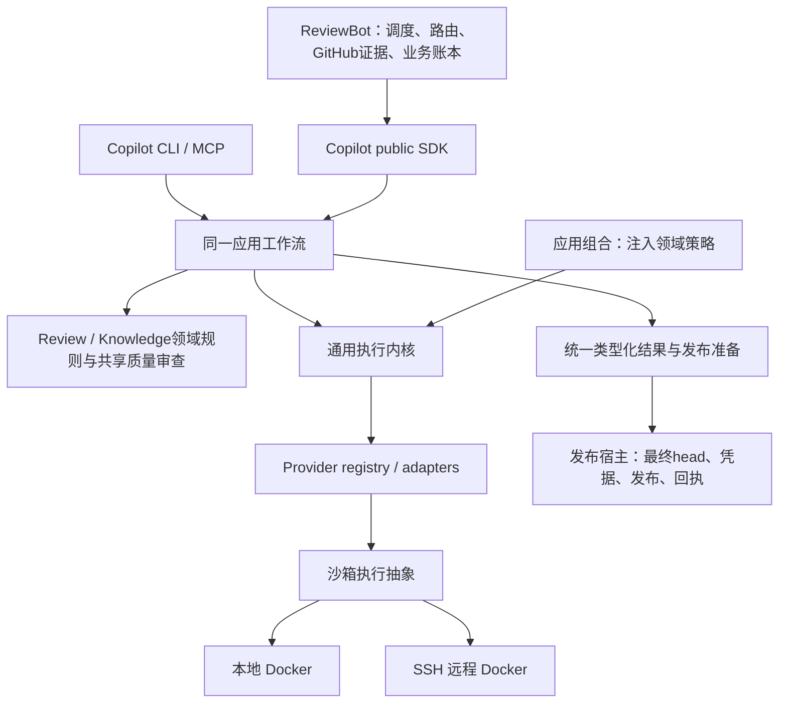

# 框架阶段最终收口 · 2026-10-17

> 本页保留框架交付1b36／24ac范围；后续当前产品e98e／24ac及其bridge／Direct修复见[当前交付](single-capability-strict-bridge-pin-delivery-20261017.md)。框架不重开，旧验证不重绑定为新产品全量验收。

**框架阶段已完成并停止扩展；完整重构目标保留，后续分阶段验收。** 当前代码配对为 Copilot `1b36ed44…`／ReviewBot `24ac7cfb…`。以下是本次统一交付入口；历史报告保留各自版本范围，不覆盖原失败、skip或unknown。

## 最终架构

Bot jobs／发布回执、Copilot runs、knowledge生命周期与领域预算分别保留权威。Docker机制通过执行抽象供本地和SSH远端共用，位置选择不另建业务循环。

## 能力归属、调用方迁移与旧实现删除

| 唯一归属 | 已迁移调用方 | 已删除主体／保留边界 |
| --- | --- | --- |
| Copilot providers／进程监督 | review、knowledge、triage、owner routing、validator、辅助命令 | Bot vendor CLI调用及解析主体、重复进程机制删除；兼容runner只转换与委托。执行策略绑定工具、凭据、schema、resume和deadline。 |
| Copilot ReviewRuntime／RunService | Direct／Strict、local／remote、SDK／CLI／MCP | Bot Direct runner／repair主体删除；统一请求、结果和持久run；旧Direct／Strict入口及strict_run_id保留委托兼容，provider_run_id为通用身份。 |
| Copilot review规则／发布准备 | findings、discussions、diff、candidate、Bot及standalone | recheck、disposition、diff index和发布资格共用；head漂移拒绝发布；最终head读取与GitHub effect仍属发布宿主。 |
| Copilot knowledge／Curator | init、intake、lifecycle、portable validators、Bot curation | 解析、ID／容量、证据规范化、验证和有界curation统一；Bot knowledge_model.py、knowledge_curation_cycle.py删除。append-only字节合同和lifecycle渲染策略保留。 |
| Copilot共享质量审查／generation | 各init步骤、Foundation、Modules、History、Discovery、depth | 派发、修复、检查点及unknown机制共用；各自机制循环删除。各步骤的schema、rubric、验收规则和领域预算继续独立。 |
| Copilot应用组合／执行抽象 | SDK／CLI／MCP、native／API、local／SSH | 执行内核的knowledge／self-improvement业务依赖移出，由应用注入；不按执行位置复制工作流。 |
| ReviewBot业务与发布 | polling、assignment、admission、fallback、业务重试、发布与对账 | 保留GitHub业务策略、凭据与回执。marker查询共用；只读GitHub transport迁到github_client，旧remote路径只保留同对象alias。原回执对账不重算、不POST。 |

[逐项机器清单](single-capability-framework-inventory.json)：**70项能力、41项原始删除记录、24个已闭环连接、0个登记的未接框架连接**。每项列owner／callers；删除记录列路径和符号，包含文件内主体，不能解释为41个文件。后续marker／只读transport迁移记录在相应能力条目内，不通过增加数字表示进度。

## 可审阅、可运行代码

- 完整双仓补丁、精确wheels与验证包 (host-local path: `/data/zhoutaichang/copilot/output/single-capability-completion-20261012/publication-original-reconciliation-20261017/publication-original-reconciliation-review.tar.gz`)，SHA256 `0bd8c7a140cb2846f8df3dcdf9720e05283b4edb742ea84f389528c23cd2f356`。
- 基线、tree和完整patch哈希 (host-local path: `/data/zhoutaichang/copilot/output/single-capability-completion-20261012/publication-original-reconciliation-20261017/code-identity.json`)；生产行数／AST变化 (host-local path: `/data/zhoutaichang/copilot/output/single-capability-completion-20261012/publication-original-reconciliation-20261017/code-delta.json`)。净减行不是验收门槛，累计与切片统计保留原范围。
- 本次收口身份与安装成员核对 (host-local path: `/data/zhoutaichang/copilot/output/single-capability-completion-20261012/framework-phase-final-closeout-20261017/identity-verification.json`)；本次必要补验 (host-local path: `/data/zhoutaichang/copilot/output/single-capability-completion-20261012/framework-phase-final-closeout-20261017/necessary-validation.json`)。本次仅文档／交付入口更新，没有生产代码变更。
- 工作树：Copilot (host-local path: `/data/zhoutaichang/copilot/wt-copilot-single-capability-20261012`)、ReviewBot (host-local path: `/data/zhoutaichang/copilot/wt-reviewbot-single-capability-20261012`)。未commit、push、创建PR或部署。

完整patch分别相对Copilot `647e6e02`／ReviewBot `1e70e983`应用一次，不能叠加到已改动树。包内保留安装／验证脚本和精确依赖证据。当前wheel完整SHA见身份核对记录；与fresh环境中的2337／130产品成员重新逐字节比对通过，现存src成员也匹配。

## 主流程结果与必要验证

**入口 → public SDK → 应用工作流 → provider → 类型化结果 → 发布准备已贯通。** Direct／Strict和local／remote使用同一请求／结果路径，stale-head拒绝、防重复派发及依赖边界已有确定性和安装证据。模型／GitHub边界使用受控回复，本次不宣称真实模型质量或真实发布通过。

- 当前Copilot产品与原完整整合的386份src及6313份测试／eval／playbook／validator输入一致；原6008项结果及4个环境skip／对应补证保留原版本范围，不将原skip改称未发生。
- 当前Bot完整2925项、安装235项通过。最后的[原发布回执修复](single-capability-publication-original-reconciliation-20261017.md)覆盖“已接受／丢响应 → head漂移 → 拒绝新发布 → 原回执结算”；原effect仍一次，模型调用为零。
- 当前配对fresh最小安装 (host-local path: `/data/zhoutaichang/copilot/output/single-capability-completion-20261012/fresh-current-pair-20261017/result.json`)通过：新venv、离线hash锁定、无源码路径注入、无MCP或site-package symlink，public SDK／curation预派发检查和实际operator console-script通过。
- 本次最后补验：Copilot执行注册／worker／native组合16项、ReviewBot回执／CLI／provider与发布边界32项通过；代码包hash和已安装产品成员重新核对通过。已有充分证据后不再扩大矩阵。

本地／SSH Docker实际控制保留[精确版本范围](single-capability-current-pair-runtime-controls-20261017.md)，不冒称本次重新运行；当前安装补验也不等同运行MCP服务或真实模型。

## 后续优先级与完整目标

| 优先级 | 后续交付与完成标准 |
| --- | --- |
| P1 真实模型质量 | 冻结完整Direct／Strict与各init整例、独立标签、相同knowledge输入、profile及预算准入后比较；保留原失败／unknown。现有真实PR oracle仍为提案，不当作质量通过。 |
| P1 深层恢复 | 原unknown／History外层ack按原身份、位置和版本对账；补崩溃／并发、费用与回执结算矩阵。不因未知结果触发替代付费运行。 |
| P2 后端与认证细节 | Codex优先；Claude／Cursor／DeepSeek等后验。完善served model／实际费用、精细预算、认证差异及Docker认证；不绕过独立family策略。 |
| 发布前验收 | 最终不可变配对、consumer pins、受控shadow、在途盘点与原环境保留／排空、rollout／rollback。框架交付不表示发布验收完成。 |

[完整计划](single-capability-completion-plan.md)的要求保留。本阶段到此收口，以上后续项不阻挡交付；仅主流程断开、依赖越界或可能重复派发的问题立即修复。没有新增模型调用，没有借用或改写原519分配与未用额度。
