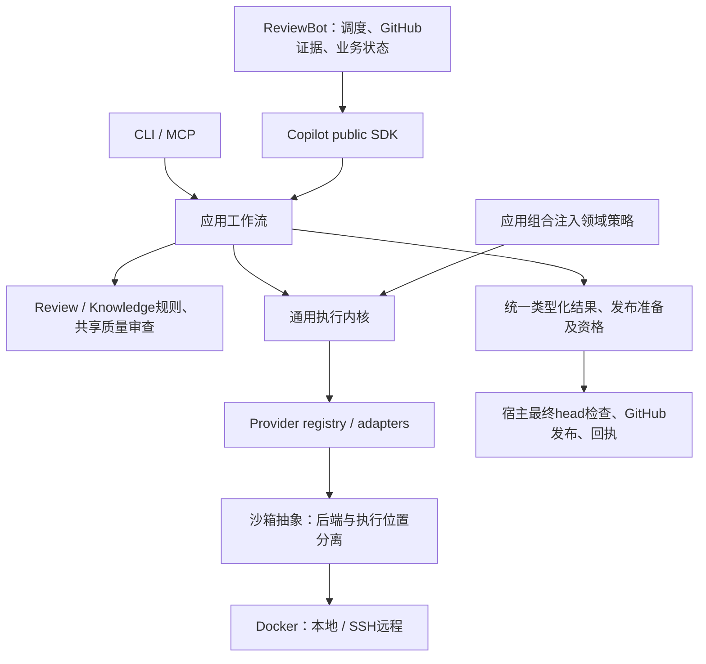

# 框架阶段收口交付 · 2026-10-17

> 本文保留1077候选的原始交付范围。当前交付请见[最终收口](single-capability-framework-final-handoff.md)，勿将下文旧wheel及验证视为当前版本。

**框架阶段完成；完整目标继续分阶段交付。** 当前修复已完成必要验证并封装，不再以真实质量、深层恢复或其他厂商矩阵阻挡框架交付。此文是当前入口，历史交付与报告保持原范围。

| 能力所有者 | 已迁移调用方 | 已删除的独立实现／边界 |
| --- | --- | --- |
| Copilot provider | Bot review、knowledge、triage、owner routing 经公共SDK | Bot vendor调用主体删除；保留转换／委托包装。 |
| Copilot review | Direct／Strict、本地／远程，统一请求、run与结果 | Bot runner／repair主体删除；strict_run_id兼容；统一head漂移拒绝。 |
| Copilot knowledge | init、intake、lifecycle、便携validator、Bot curation | 解析／证据／约束／验证／有界curation唯一归属；Bot knowledge_model.py、knowledge_curation_cycle.py删除；导出恢复留宿主。 |
| Copilot共享质量 | 各init步骤 | 派发／修复／检查点共用，步骤验收策略保留。Foundation owner／feature共用有界测试证据组装，删除各自组装主体。 |
| Copilot应用层 | SDK／CLI／MCP、shadow worker | 通用runner删除review关联知识策略，改为注入；内核不导入knowledge／self-improvement业务。 |
| Copilot执行机制 | API／native、local／SSH | provider与沙箱位置分离；同一用量观察／投影，不合并领域预算权威。 |
| Copilot预览完整性 | init缓存恢复、阶段串联、portable回执／接受、history | preview.py唯一读取／文件集／哈希校验；删除portable独立校验循环，普通init／history写同一回执。旧记录只读原prepared证明，篡改不补签、不重派。 |
| ReviewBot业务／发布 | polling、admission、路由、业务重试、发布对账 | 保留GitHub凭据、最终head读取、业务账本与回执权威。 |

逐能力归属、调用方、删除符号和兼容包装见[机器清单](single-capability-framework-inventory.json)：64项能力、24项删除条目、22个已闭环连接、待接框架连接为空。这不表示后续验收全部完成。

## 可审阅代码与运行入口

Copilot工作区 (host-local path: `/data/zhoutaichang/copilot/wt-copilot-single-capability-20261012`)及ReviewBot工作区 (host-local path: `/data/zhoutaichang/copilot/wt-reviewbot-single-capability-20261012`)保留全部代码，未commit／push／发布。统一交付包包含双仓完整基线补丁及后续overlay，按code-chain.json顺序应用一次；每包保留before／after、校验、wheel及报告。也可直接安装最终wheel，按最新修复包installed.py复现定向验证。

统一交付包 (host-local path: `/data/zhoutaichang/copilot/output/single-capability-completion-20261012/framework-closeout-final-20261017/framework-review-delivery.tar.gz`)；应用顺序与哈希 (host-local path: `/data/zhoutaichang/copilot/output/single-capability-completion-20261012/framework-closeout-final-20261017/code-chain.json`)；最终修复代码及报告 (host-local path: `/data/zhoutaichang/copilot/output/single-capability-completion-20261012/preview-integrity-20261017/README.md`)。

最终Copilot wheel `10775b23c2f8da666de95618c1b241055de9476eaf2da665c7a0439a7ab44bfb`，Bot `3bbf71df48a24eb05f6d07cb68fe145f8c2cd15b22f17a2f182dba4a7d001860`。当前修复相对9375为6个生产文件、+106行／+689 AST节点，其他wheel资源未变，Bot未改。此前完整整合相对原基线的累计生产变化及各overlay变化分别保留在原报告；不把净行数当验收门槛。

## 主流程与当前验证

入口 → SDK → 应用工作流 → provider → 类型化结果 → 发布准备已贯通。当前安装包验证覆盖Direct／Strict及Bot本地／远程、发布恢复；保留head漂移拒绝及未知付费结果不得重新派发。模型／GitHub边界使用受控回复，无真实发布。

- copilot：150项，零失败／错误／skip。
- boundary-source：24项，零失败／错误／skip。
- bot-boundary-source：11项，零失败／错误／skip。
- installed-mainflow：47项，零失败／错误／skip。
- installed-bot-mainflow：127项，零失败／错误／skip。

最终修复的相关安装验证覆盖篡改、文件增删、链接／异常文件、删除回执、换行兼容、旧证明读取、缓存拒绝时检查点不变，以及history／portable流程。使用正常venv与精确wheel、无产品源码路径注入；依赖复用，不称fresh最小安装。最初把依赖源码路径的边界测试放入安装环境导致缺文件，原失败日志保留；边界检查已在源码树通过。旧源码105／115结果早于最后换行兼容补充，最终安装选择覆盖当前代码。

更广配对整合、Docker本地／SSH进程控制及防重证据属于此前e3eb／Bot3bbf，不重绑定为最终wheel全量验收。真实Codex：旧Strict和b7e6 Direct仅有单个冻结案例结论；9375 Foundation两臂各11调用均终态、无新unknown，但完整案例质量未通过。当前修复零新模型调用，未修改旧样本、标签或账本。

## 后续优先级（完整目标保留）

| 优先级 | 工作 | 完成标准／限制 |
| --- | --- | --- |
| P1 质量 | Foundation临时执行provenance不得进入可复用知识；补足顺序／拒写与记账不变量等解释，继续各init冻结质量比较 | 测试证据存在不等于已执行或语义覆盖；保留历史SYSTEM版本／冻结任务，不用pass数代替质量，也不原样重跑旧样本。 |
| P1 恢复 | 原unknown按原身份对账；深层崩溃、并发、回执结算矩阵 | 不重置旧账本，不复用旧闲置分配，不因未知响应触发新付费调用。 |
| P2 机制细节 | 实际费用／served model、预算精细对账、认证与Docker认证完善 | unknown明确保留，不影响当前已闭环的所有权边界。 |
| P2 后端 | Claude／Cursor／DeepSeek等原生能力与认证矩阵 | 按用户决定先Codex，其余后验。 |
| 最终发布 | 最终配对完整套件、安装包、shadow质量、release／pin、回滚及在途原环境保留／排空 | 框架交付不代表上线验收或发布授权。 |

当前没有待接框架连接；不再扩展本轮代码修复。后续只有主流程断开、依赖越界或可能重复派发的问题立即处理，其余按上述阶段推进。
