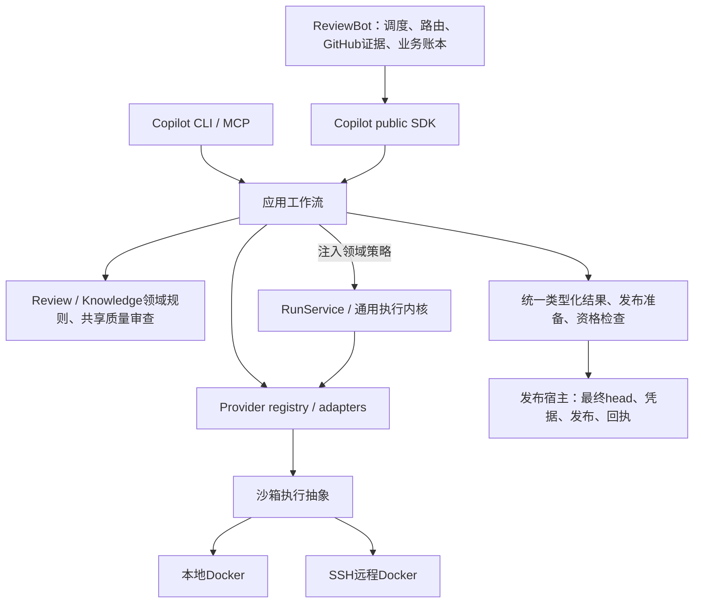

# 框架阶段交付 · 2026-10-17

> 框架阶段当前收口入口：[single-capability-framework-closeout-current-20261017.md](single-capability-framework-closeout-current-20261017.md)。当前必要修复与安装主流程已通过；完整目标按后续优先级保留。以下历史版本记录保持原范围。

> 当前配对的后续确定性整合已闭环：[single-capability-current-paired-85ef-a57-integration.md](single-capability-current-paired-85ef-a57-integration.md)。框架原封存包不改写，完整质量与最终发布仍开放。

> 后续框架安全补正：[single-capability-legacy-review-restart.md](single-capability-legacy-review-restart.md)修复旧无身份记录重启可能重复派发的问题；当前新配对与验证另列，原封存包不改写。

> 本页保留34aa框架封存范围；后续生成指导切片见[single-capability-history-obligation-policy.md](single-capability-history-obligation-policy.md)，其新wheel不继承原完整整合或真实质量结论。

框架阶段在此收口。当前交付固定为Copilot **34aa835b**／ReviewBot **3bbf71df**：主流程与必要修复验证通过，登记中没有待接框架连接。完整目标保留；真实模型质量、深层恢复、其他后端及发布验收进入后续阶段。其他旧报告保留原版本范围，以本页及关联机器结果为当前入口。

Docker执行机制与位置分离；ReviewBot业务账本、Copilot runs、knowledge生命周期及领域预算分别保留权威。

## 能力归属、迁移与删除

| 唯一归属 | 已迁移调用方 | 删除与兼容 |
|---|---|---|
| Copilot providers / transports | review、knowledge、triage、owner routing | Bot vendor CLI和独立模型修复主体删除；包装只转换和委托。 |
| Copilot ReviewRuntime / RunService | Direct／Strict、local／remote、SDK／CLI／MCP | Bot runner／repair主体删除；旧Direct API、StrictRuntime、strict_run_id兼容；新增provider_run_id，Direct持久执行。 |
| Copilot review领域 | finding recheck、discussion、diff、candidate、发布准备 | 共用领域检查与发布资格；最终head由发布宿主读取，漂移拒绝发布。 |
| Copilot knowledge领域与Curator | init、intake、lifecycle、便携validator、Bot curation | 共用解析／ID／容量／证据／验证；删除Bot knowledge_model.py、knowledge_curation_cycle.py；append-only与lifecycle渲染合同保留。 |
| Copilot共享质量审查／generation | 各init阶段及Skeleton、rules／Deepen、Modules、History | 共用派发、修复、验证、检查点；各阶段保留schema、rubric、验收与预算策略。删除原直接generate主体与History独立派发包装。 |
| Copilot路由／引用／source row | 通用init、History及quick maps | owner_for_paths、CitationPolicy与source-row解析各自唯一；原路由／引用主体改委托。当前修复保持旧History v0／v1／v2请求，v3忽略生成的尾部source row判断行为重复。 |
| 应用组合与沙箱接口 | SDK／CLI／MCP、native／API、本地／SSH | 执行内核不导入领域逻辑；位置策略不形成独立业务循环。 |
| ReviewBot与发布宿主 | polling、assignment、admission、fallback、业务重试、发布对账 | 保留GitHub凭据、业务状态、最终head、发布及回执；只调用public SDK。 |

[完整能力／调用方／删除清单](single-capability-framework-inventory.json)：69项能力、33项删除记录（包括主体删除，不等同于文件数）。未关闭框架连接为空；这是当前登记与边界测试的结论，不替代后续验收。

## 主流程与必要验证

- 入口→public SDK→应用工作流→provider→类型化结果→发布准备：当前精确wheel安装验证通过，覆盖Direct／Strict、local／remote与stale-head拒绝；受控回复，不宣称真实模型质量或真实GitHub发布。
- 双仓依赖边界通过：Bot只用public SDK，领域不反向依赖SDK／transport，执行内核通过注入获得领域策略。
- 当前source-row／重复行为修复先复现回归，再通过源码与安装包定向验证；旧History v0／v1／v2实际请求逐字节保持；未知原调用不重派。
- fresh、hash-locked、无MCP／产品src注入／安装依赖软链的最小消费者通过。当前wheel在Personal-Agent正常安装与Docker中逐成员核对；真实local／SSH stdio、streaming、超时、取消及重复执行拒绝控制通过。
- 四PR受控History完整提取→aggregate→导出通过：201／202／203采用、无对应模型页的204拒绝、完成后resume零新增调用。这是接线验证，原真实比较失败结果不改。
- 后续原Copilot完整suite已终态，与ReviewBot及eval完整suite均零失败／错误。[精确整合记录](single-capability-current-paired-34aa-integration.md)另行封存；源码4个环境skip保留，精确同名同源码的当前安装包／真实namespace补验通过。框架交付包保存封存时“全套仍运行”的原始快照，不改写旧包。

机器结果、原命令、JUnit、安装与实际沙箱证据见交付结果 (host-local path: `/data/zhoutaichang/copilot/output/single-capability-completion-20261012/current-paired-34aa-integration-20261017/framework-delivery/framework-result.json`)与验证目录 (host-local path: `/data/zhoutaichang/copilot/output/single-capability-completion-20261012/current-paired-34aa-integration-20261017`)。生产文件已再次核对与测试冻结输入一致，没有为收口增加产品改动或新模型派发。

## 可审阅代码

完整双仓交付包 (host-local path: `/data/zhoutaichang/copilot/output/single-capability-completion-20261012/current-paired-34aa-integration-20261017/framework-delivery/framework-review.tar.gz`)包含相对原始Copilot647e6e02／ReviewBot1e70e983的完整binary patch（含新增／删除）、精确wheels、架构与清单、必要验证及私有index重建证明。每个patch只对对应原始基线应用一次，不要叠加到已有变更树；正常Python3.12环境安装两个wheel，命令与可复现范围见包内README.md和commands文件。

生产统计相对原始基线：Copilot244文件净+12982行／+96495 AST，Bot37文件净−1583行／−3206 AST；相对保留的重构前源码：Copilot172文件+9731行／+76337 AST，Bot12文件+36行／+490 AST。包括此前保留工作；净减行不是交付门槛。当前修复另为2生产文件+33行／+298 AST。

当前工作树：Copilot (host-local path: `/data/zhoutaichang/copilot/wt-copilot-single-capability-20261012`)、ReviewBot (host-local path: `/data/zhoutaichang/copilot/wt-reviewbot-single-capability-20261012`)。未commit、push、创建PR、发布或部署。

## 后续优先级

| 优先级 | 后续项与完成条件 |
|---|---|
| P1 真实Codex质量 | 当前版本冻结的Review／各init完整案例与跨步骤质量比较；保留Foundation／History原失败。499比较仅准备，未准入或派发，不阻挡框架。详情见[质量范围](single-capability-quality-current-scope.md)。 |
| P1 深层恢复／对账 | 崩溃窗口、并发、预算和发布回执结算；旧unknown只按原位置／版本／profile／业务键对账，不能触发替代付费运行。 |
| P2 其他后端与机制细节 | 其他vendor原生验证、认证差异、Docker认证完善、served identity和精细费用。遵循Codex优先，其他后验。 |
| 发布前最终验收 | 最终精确配对全套、不可变releases／pins、受控shadow、在途环境保留或排空、回滚与rollout。框架交付不代表生产发布就绪。 |

完整要求继续保留于[完成计划](single-capability-completion-plan.md)。只有阻断主流程、破坏边界或可能重复派发的问题立即处理；其余按后续优先级交付。
