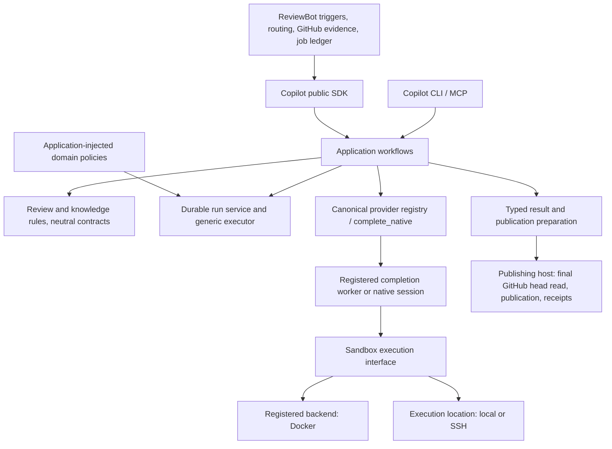

# Framework delivery: Copilot and ReviewBot

框架阶段收口（2026-10-16）：当前可交付范围、精确 P0a38/B939 包、必要验证及后续优先级以 [框架交付](single-capability-framework-handoff.md) 为准。下文保留历史证据原范围；P7e64 与旧离线包不是当前状态快照修复后的包。真实模型与深层恢复不再阻挡框架交付，完整目标保留。

Status: framework implementation is reviewable; original final acceptance remains
open. This document records the current boundary, not model-quality or release
approval. Exact evidence is indexed by the
[implementation journal](single-capability-completion-progress.md) and
[machine-readable inventory](single-capability-framework-inventory.json).
External rebase-agent / EXT1 is retired by user instruction; internal rebase
remains supported and tested.

Current production pair: Copilot
`7e643f114b2666de25e7e37625549a139018e40a4fbbb00204986f57594d344c` /
ReviewBot `9399980b86403b3d83682ba06bce56da9512145ba1a13b127b9584e4f520e23b`.
Current production/resources and product tests still match the completed paired
source run. Its raw three environmental skips have exact installed/remote
complements; all seven exact-pair installed groups and public SDK checks pass.
Evaluation-only role/phase/report changes have their own source/installed v3
checks. The current [acceptance audit](single-capability-acceptance-audit.md)
indexes exact evidence and limits without rebinding historical reports.

The common init role policy, provider transports, quality runner and application
workflows own execution; callers preserve their own acceptance/business policies.
Real History recovery reuses original generation and dispatches only the original
aggregate. Both judges refuse unsupported source navigation, so quality approval
remains incomplete. Corrected foundation prose supplements pass; full foundation
coverage remains incomplete. The remaining-five Codex phase is separately frozen;
its original process/ledgers own its status. Discovery and unlimited module-card
native coverage remain deferred under unchanged domain policy and Codex-first
instructions. Original unknown outcomes remain pending, not retried.

## Historical native mechanism evidence

The following native Direct evidence retains its earlier D1da scope:

The earlier runnable framework is Copilot `d1da78bd` / ReviewBot `9399980b`.
The exact installed pair passes all seven groups via retained original reports
and documented fixture complements. The shared directory codec, sanitized Git
snapshot owner and complete clean Codex image pass real SSH source/tool checks.
Full public-SDK Direct reads the exact head/source, executes the labeled
counterexamples, returns the expected defect and fixed carried outcome, prepares
publication under the same head and refuses drift. It uses one native dispatch;
recovery adds none and no publication occurs. Current evidence:
`codex-direct-clean-runtime-20261016` and
`codex-native-runtime-20261016/paired-artifacts/complements-v2/result.json`.

The inventory records framework ownership closure. Independent native quality
and release acceptance remain open; current deterministic source evidence is
indexed separately in the acceptance audit. One-case precision/severity details
are recorded without adjusting frozen labels; all other-backend native matrices
remain deferred by user decision. The earlier failed helper/configuration
runs, images and unknown Discovery retain their original identities.

The earlier candidate is Copilot `73697bd2` and ReviewBot `9399980b`. Real local/SSH
CLI account controls pass after canonical encrypted-cache support. Current
deterministic source/installed integration passes; quality and release remain open. The following S25 workflow evidence remains
historical, with its original artifact scope. Full
original/current unlimited modules pass local Docker and SSH Docker. Full
original/current capped primary-feature Discovery passes local/SSH Docker, including
live original pacing, candidate review, boundary/consolidation review and resume
without model dispatch. The Discovery worker contains the exact current wheel.
Four-way publication content, pins, verdicts and coverage match. Evidence:
`native-discovery-mixed-20261016/four-way-evidence.json`. These scripted native CLI fixtures prove
mechanism conformance; independent model quality remains a separate gate.

The same four-way workflow also passes six-candidate relationship conformance:
aliases, implementation supplements, subcapabilities and shared components merge;
outdated candidates are excluded without denominator inflation. Evidence:
`native-discovery-relationships-20261016/evidence.json`. The primary-approved/out-of-boundary rejection scenario now also passes all four
combinations at `discovery-boundary-exclusion-20261016/evidence.json`. Canonical
chain/cycle rules retain domain coverage; extra native variants are supplementary.

The complete production source suites and all six isolated paired-wheel groups are terminal.
A new installed evaluation group and all maintained evaluator source tests also pass;
see `installed-evaluation-gate-20261016/evidence.json` for exact frozen scope/addenda.
The source suites' three environmental skips have exact current-artifact
complements; raw reports remain preserved. See the
[current candidate record](single-capability-release-candidate.md) for precise
evidence and remaining scope. Historical evidence below retains its original
artifact identities and does not supersede this current record.

## Runtime boundary

Backend and location are independent trusted configuration. Docker lifecycle,
remote exchange and native provider policy each have their own owner. A workflow
selects a profile; it does not build Docker or SSH commands. The execution kernel
receives domain policies through composition and does not import knowledge or
self-improvement business logic.

## Owners, migrated callers and deletions

| Capability | Owner | Migrated callers / removed bodies |
| --- | --- | --- |
| Providers and native execution | Copilot provider registry, adapters, `complete_native` | Bot Direct, knowledge, triage and owner routing use public SDK. Bot vendor invocation and repair bodies are removed. |
| Generic contained completion worker | Copilot `providers/completion_worker.py` | ZCode delegates its existing adapter once inside the configured sandbox. Registry capabilities select providers; Docker/SSH remain shared. Native vendor invocation, spool, event/tool decoder and accounting stay with their original owners. |
| Native executable identity | Copilot `providers/native_identity.py`, inherited by provider base | Codex and ZCode, evaluation transport preparation and legacy Codex CLI control share the same reader/validator. The former Codex implementation bodies are deleted. |
| Native credential source | Copilot credential source reader and registered adapter projection | Local/SSH sandbox profiles share the opaque sidechannel. Codex private reader body is removed; legacy config delegates. ZCode exports selected coding-plan keys only; zero-model account controls and original receipt decoding remain canonical. |
| Full native depth evaluation | `init_native_arm` delegates installed `knowledge-deepen`; `arm_runtime` binds canonical dispatch context | Strict/lightweight leaf entries share composition, preserving their distinct capped acceptance policies. Actual local/SSH fixture runs match and resume without dispatch; production implementation remains unchanged. |
| Knowledge model-family identity | `kb_service.model_identity.model_family` | Role configuration, init, maintenance/correction/native replay and depth auditing delegate. Role versus qualified served-name policies preserve historical decisions; duplicated function bodies and inline parsers are removed. |
| Original SDK mixed-provider completion | `legacy_provider_host` translates objects; current `ArmRuntime` / canonical providers own execution | Old workflows retain their policies and delegate once to a hash-bound current host. Per-provider executable bindings replace the coordinator's v1-only assumption. Full original/current modules pass local/SSH Docker fixtures. Live event forwarding preserves original Discovery pacing and delegates partial snapshots to the registered adapter; local/SSH full Discovery passes. Unsupported capabilities and default payload omission refuse. |
| Foundation correction evaluation | `model_gateway` / canonical provider, durable recorder and `role_profiles.fixture_providers` | Explicit fixture generators are separate from native judges. The former Codex capture subclass is deleted; original/current local/SSH Docker correction and no-model completed-stage reconstruction pass. |
| Evaluation identity controls | `ArmRuntime` | Gateways and legacy hosts share per-instance zero-model scopes. The host's independent allocation is deleted; paid identity and ledgers keep their fixed original roots. |
| Frozen evaluation identity | `arm_runtime.model_roles` / `judgment_context` | Init role selection and all five judgment entries delegate. Fixture model/timeouts and independent role/settings constructors are removed; conflicting overrides refuse before input preparation or dispatch. |
| Trusted provider options | Copilot `providers/provider_options.py` | Registry, native worker and attempt preparation share the whitelist, canonical Settings validation and copy-scoped overlay. Original profiles/run pins freeze values without a new durable schema. |
| Direct / Strict review | Copilot application and durable run service | Both modes and both execution locations use typed requests/results. Bot retains scheduling and business recovery. |
| Review rules and publication preparation | Copilot review domain | Shared diff index, finding/discussion checks and stale-head eligibility; publishers retain final head reads and delivery receipts. |
| Knowledge format, evidence and validation | Copilot knowledge domain | Curation, lifecycle, intake and portable validator commands delegate canonical rules. SDK exports preserve serialization. |
| Knowledge curation | Copilot `KnowledgeCurator.curate` | Bot model/repair cycle files deleted; export/recovery remains in Bot. |
| History payload selection | Copilot `kb_service/init_history.py` | CLI/workflow/SDK applications use the same trusted host choice and original batch binding. Current evaluation no longer forces omitted payloads into recording; legacy translation is retained only for older installed APIs. |
| Original sandbox result recovery | Copilot `SandboxExecution.read_result` | Docker and SSH use retained execution bindings. The remote agent retains request-to-worker validation; its compatibility reader and local request-matching APIs delegate the canonical original-result reader. Remote callers need not reconstruct inputs. |
| Quality execution | Copilot `kb_service.quality_review` | Init blocks, parallel foundation, depth, discovery, history and maintenance delegate dispatch/accounting/receipts/checkpoints. |
| Init evaluation composition | `eval/single-capability-shadow/init_native_arm.py` | All nine maintained native/legacy foundation, screening, history, module and full Discovery entries delegate. Standalone stage/capture/resume/correction orchestration is deleted. Shared implementation and imported fixture policies are hash-bound in new manifests. |
| Durable evaluation worker | Copilot `RunService` / public SDK; host `durable_worker` policy composition | Both Strict drivers use the standard child; queue interception and private in-process execution are deleted. Stable qualified repair steps bind `agent-step/1`; one frozen forge adapter serves parent and child. |
| Frozen evaluation model roles | `eval/role_profiles.py` | Codex legacy translation and current registered-provider composition share frozen role identity. Version-2 plans bind separate provider profiles, hashes and canonical decoders; unsupported old mixed packages refuse before dispatch. Model-family and subscription policies remain in the domain. |
| Domain accounting | Each domain ledger | Shared native facts/hooks; separate quota policy and journal authority. Unknown usage is explicit. |
| Publication and GitHub business state | ReviewBot / publishing host | No provider result settles a publication receipt. Unknown remote outcomes remain pending. |

The inventory records exact files, callers and deleted symbols. Compatibility
surfaces translate or delegate; they do not keep an independent model, validation
or repair loop. PR-history's retention contract is now accepted explicitly:
durable native execution may require `KB_INIT_HISTORY_PAYLOADS=retain-private`;
default omission keeps refusing before dispatch. Omission-compatible durable
recovery is not a required connection. The application owns the choice and freezes
it per original batch; the profile itself cannot authorize retention. Evidence:
`durable-evaluation-worker-20261015/history-retention-decision.json`.

## Init quality review: shared mechanism, explicit policy

| Caller | Policy that remains distinct |
| --- | --- |
| Screening and module cards | Block/source grounding and routing outcomes; independent accepted work survives another block's rejection. |
| Foundation knowledge | Per-owner/facet acceptance and bounded correction; rejected facets are excluded. |
| Depth review | Facet completeness and strict/lightweight evidence requirements. |
| Feature discovery | Evidence, boundary membership, canonical relationships and catalog acceptance. |
| PR history | Exact complete aggregate diff and owner routes; approval binds the prepared head. |
| Maintenance audit | Source-claim verdicts and maintenance-specific outcomes/cache identity. |

The shared runner supplies execution policy, accounting, trace/receipts and
checkpoint mechanics. Each caller supplies its schema, rubric and acceptance
function. Consolidation does not make these acceptance contracts identical.
Unlimited initialization still requires its configured zcode generator and an
independent Codex judge. Capped Codex foundation conformance does not replace that
policy or prove unlimited account parity.

## Encrypted native credential source

ZCode 0.16.9 `enc:v1` selected values now decode in the provider projector, using
its native secret or the trusted source owner's home/name fallback. Only the
selected identity/key enter the existing private sidechannel. Source caches,
other accounts and refresh state remain outside it. Encrypted inputs require
cryptography (provided by the `kb` extra); plaintext inputs stay compatible without
it. Real native local/SSH zero-model controls pass, with original executable and
new worker identities verified. See `encrypted-zcode-cache-20261016/evidence.json`.
This encrypted-cache slice is historical. Current P7e64 integration evidence is
indexed below; the older slice reports retain their original artifact scope.

## Current verification and limits

The current P7e64/B939 pair passes the exact deterministic source/installed/SDK
and resource gates with explicit environmental complements. Current-source bytes,
product tests and reconstructed installed evaluation inputs are verified at
`current-acceptance-audit-20261016/current-source-proof-v2.json`. The original raw
full source report is unchanged; later evaluation-only updates use their own v3
reports. Remote namespace/resource complements use supported Python3.12.13.

The immutable production review artifact is
`framework-review-bundle-role-admission-20261016/paired-framework-review.tar.gz`.
It contains baseline patches, exact wheels, architecture, owner/caller/deletion
inventory, size metrics and validation records. Private index reconstruction
verifies resulting source bytes and deletions without changing either checkout
or original Git objects. Updated evaluation code/tests are separately reviewable
in `framework-evaluation-v3-addendum-20261016/review-addendum.tar.gz`; subsequent
audit-only prose is visible in the working tree and historical copies are retained.

Real Codex identity/account and completed native workflow receipts are distinct
from older scripted native CLI conformance. Requested identities are frozen;
missing served model/invoice cost/usage stay explicit. No zero-model identity or
TLS control proves inference quality. Native quality, complete backend/recovery
acceptance and final immutable release/retention/rollout remain open. The current
acceptance audit records the ten-case disposition and original pending execution.
No commit, consumer pin, publication or deployment was performed.

## Production-code size report

Against the audited original revisions, current `src` changes are Copilot:
229 changed files, +11,791 lines / +88,322 Python AST nodes; ReviewBot:
37 changed files, -1,605 lines / -3,345 AST nodes. These totals count tracked/nonignored production `src` files, including non-Python
resources in line/file counts and Python only in AST counts. They include preserved
earlier changes and new capabilities, exclude tests/docs/eval, and do not claim
net code reduction. Exact per-file hashes and deltas are in the current review
bundle's `cumulative-production-delta.json`. Inline JavaScript counts as Python
string AST only. Line reduction is not a release gate.

## Remaining delivery priorities

| Priority | Work | Completion evidence |
| --- | --- | --- |
| P1 | Native backend/account/recovery acceptance | Complete the remaining supported-native matrix; account projection and framework conformance are already connected. Preserve original unknown outcomes and environments. |
| P1 | Complete native generation/extraction and full-stage scope in all ten quality strata | Frozen representative inputs, independent labels, admitted per-call budgets and retained original/candidate receipts. Fixtures alone are insufficient. |
| P2 | Detailed accounting and Docker/vendor auth completeness | Domain reconciliation and native account proofs without relaxing capability policy. |
| Release gate | Final paired artifacts, quality assessment and rollout retention | Reviewed immutable pair, installed-wheel validation, release approval and drain/retain plan for in-flight runs. |

Any newly found duplicate dispatch path, broken dependency boundary or missing
main-flow connection takes precedence over these verification details. The
original full completion plan remains in effect; framework delivery does not
close that goal.
