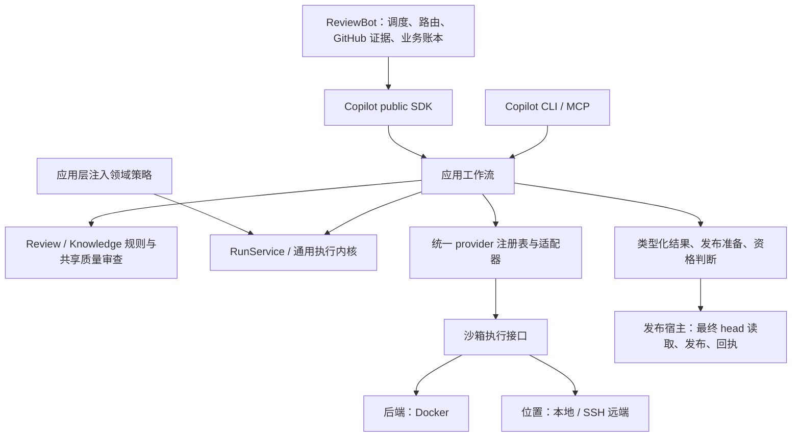

# 框架阶段最终交付 — 2026-10-16

框架阶段已收口：能力归属、调用方迁移、重复主体删除及可运行主流程已交付。完整目标保留在 [completion plan](single-capability-completion-plan.md)，真实模型质量、深层恢复、其他后端及发布验收进入后续阶段，不再阻挡本次框架交付。本文件是当前交付入口；其他文档中的旧候选和旧报告保留原身份，不代表当前包的验证范围。

Docker 后端与执行位置独立。业务任务、Copilot run、knowledge 生命周期及预算账本分别保留权威；执行结果不能代替发布回执。

| 能力与唯一归属 | 已迁移调用方 | 删除与兼容方式 |
| --- | --- | --- |
| Copilot provider / process / structured completion | Bot review、knowledge、triage、owner routing | 删除 Bot vendor 调用及模型修复主体；兼容层只转换和委托 |
| Copilot ReviewRuntime / RunService | Direct／Strict，local／remote，SDK／CLI／MCP | 统一请求与类型化结果；保留委托式旧 API 和 strict_run_id，新增 provider_run_id |
| Copilot review domain | review 工作流及发布准备 | 统一 finding、discussion、diff、candidate 和发布资格；head 漂移拒绝发布 |
| Copilot knowledge domain / neutral contracts | init、curation、lifecycle、intake、便携校验器 | 统一解析、ID、容量、证据和格式规则；SDK 导出及命令包装委托 |
| Copilot KnowledgeCurator | Bot knowledge adapter | 删除 knowledge_model.py、knowledge_curation_cycle.py；业务导出／恢复保留在 Bot |
| Copilot quality_review / 应用组合 | screening、foundation、depth、discovery、history、maintenance | 共用派发、修复、验证和检查点机制，各步骤保留自己的 rubric、schema 与验收策略 |
| ReviewBot／发布宿主 | scheduler、GitHub adapter、publisher | 保留调度、路由、业务重试、最终 head 读取、发布及回执；只使用 public SDK |

逐文件、符号、调用方和删除记录见 [能力清单](single-capability-framework-inventory.json)：64 项能力、24 项删除记录，未关闭的框架连接为 0。删除记录包括文件整体删除和文件内主体删除，不等同于删除文件数。更细的 init 策略和历史证据见 [delivery map](single-capability-framework-delivery.md)。

本次最终修复补齐了恢复安全边界：pending 或损坏的原生调用事实在 archive 写入前拒绝；无法核验原始 receipt 时保留待对账语义并禁止 fallback。正常成功记录、重复恢复及旧缺索引记录仍可恢复。它复用现有 trace／attempt 和共享质量审查包装，没有新增业务循环。

| 主流程／边界 | 验证结论与范围 |
| --- | --- |
| 入口 → public SDK → 应用 → provider → 类型化结果 → 发布准备 | Direct／Strict 安装包流程、public SDK consumer smoke 通过；使用故障注入／fixture，不宣称真实模型质量通过，无实际 GitHub 发布 |
| 调用与依赖边界 | public SDK、能力归属、通用内核策略注入及重复主体检查通过；当前修复没有新增跨层依赖 |
| local／remote、沙箱与 portable validator | 3f27 候选的双仓集成通过；源码 3 项环境 skip 有逐项同字节安装包／真实远端 namespace 补验，原始 skip 和 strict no-skip=false 保留 |
| 当前恢复修复 | 源码与全新离线安装包定向检查均通过，无失败／错误／skip；修复前六种回归均可复现，修复后拒绝不修改原 archive／journal、不增加派发 |
| 防重复派发 | 未决结果保持 interrupted／pending，禁止自动 fallback；原有付费未知调用及环境保留，不重放、不改身份 |

精确验证身份：上一整合候选 Copilot wheel 为 `3f272fc392f9df696699fc043f593d744af63e5e597743bdc3d59ac8f9649225`，已完成双仓源码、七组安装集成及环境补验。最终恢复修复的 Copilot wheel 为 `0a31af6a980b478540657f082d872401060f3c016a687dc8f3c799bd9389452f`，完成必要定向源码／安装包及 public SDK 检查，未宣称新包已完成全量重验。ReviewBot wheel 均为 `9399980b86403b3d83682ba06bce56da9512145ba1a13b127b9584e4f520e23b`。

可审阅代码与复现材料位于 `/data/zhoutaichang/copilot/output/single-capability-completion-20261012/`：

| 材料 | 路径与用途 |
| --- | --- |
| 完整双仓代码包 | `worker-cleanup-frames-20261016/consolidated-paired-review.tar.gz`；相对原始 647e6e02／1e70e983 的完整补丁、新增／删除、精确 wheels、离线依赖、重建证明 |
| 最终修复包 | `native-recovery-refusal-20261016/native-recovery-review.tar.gz`；代码／测试 overlay、当前 wheel、回归与通过报告；源码／测试补丁接在完整代码包之后，文档基线另见包内 README 与 base-* |
| 全量集成终态 | `integration-worker-cleanup-closure-20261016/result.json`；3f27 原始源码／安装集成及环境补验索引 |
| 当前必要验证 | `native-recovery-refusal-20261016/result.json`、`sdk-result.json`、`source-v2.xml`、`installed.xml` |

完整代码包 SHA256：`e3db48b2abcd7bd5757e80f9ab66db4ccd6f7297c493bd4a4db2a7031cec5694`。最终修复包 SHA256：`c89b10e593271182bcb846687c8070574bdea731a07d4fbd0d898df48b673235`。当前双仓 worktree 也可直接审阅：`/data/zhoutaichang/copilot/wt-copilot-single-capability-20261012` 与 `/data/zhoutaichang/copilot/wt-reviewbot-single-capability-20261012`。尚未 commit、push、修改发布 pin、发布或部署。

规模透明记录：3f27 相对原始基线的生产代码为 Copilot 231 文件，净增 12,042 行／90,253 Python AST 节点；ReviewBot 37 文件，净减 1,605 行／3,345 节点。最终修复另改 Copilot 两个生产文件，净增 11 行／107 节点。统计包含保留的既有修改，排除测试／文档／eval；总行数下降不是验收门槛。

| 后续优先级 | 工作与完成条件 |
| --- | --- |
| P1：原未知结果与恢复安全 | 保留原 Strict／Discovery 的执行位置、版本、profile、业务键、账本和环境；取得原始终态证据再对账，不能以本地退出或缺回执授权另一次付费运行 |
| P1：真实模型质量 | Codex 优先，补齐冻结 Direct／Strict 和各 init 分层比较；已有拒绝／失败样本保留，不以 fixture 或单案例代替整体质量结论 |
| P2：深层恢复／预算／回执 | 补齐崩溃点、已知失败恢复、并发、实际用量／超支与发布回执结算矩阵；unknown 保持显式 |
| P2：其他后端与认证 | 后续验证其他厂商、served identity、Docker 凭据、工具限制、取消、resume 和 partial output |
| P2：知识产物质量 | 集中处理生成链接、foundation 覆盖、规则候选及语义质量；修改产物后重新验证 |
| 发布验收 | 对最终候选再做配对集成、审阅不可变提交、固定 release／pins、完成回滚和旧环境保留／排空方案 |

框架阶段没有待接的主流程连接或登记中未关闭的旧主体迁移。后续若发现阻断主流程、破坏边界或可能重复派发的问题立即修复；其余按上述清单交付。框架交付完成不等于完整目标或生产发布验收完成。
