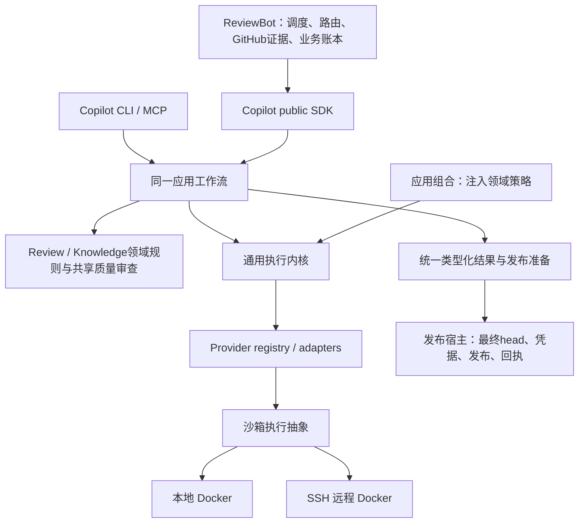

# 框架阶段最终收口 · 2026-10-18

框架阶段本次正式收口，完整重构目标保留，按后续优先级完成。最终工作候选是 Copilot `98554010…`／ReviewBot `24ac7cfb…`。本页替代先前交付入口；旧版本证据不自动视为新候选的完整验收。

## 最终架构

Bot jobs／发布回执、Copilot runs、knowledge生命周期与领域预算分别保留权威。Docker机制通过执行抽象供本地和SSH远端共用，位置选择不另建业务循环。

## 能力归属、调用方迁移与旧实现删除

| 唯一归属 | 已迁移调用方 | 已删除主体／保留边界 |
| --- | --- | --- |
| Copilot providers／进程监督 | review、knowledge、triage、owner routing、validator、辅助命令 | Bot vendor CLI调用及解析主体、重复进程机制删除；兼容runner只转换与委托。执行策略绑定工具、凭据、schema、resume和deadline。 |
| Copilot ReviewRuntime／RunService | Direct／Strict、local／remote、SDK／CLI／MCP | Bot Direct runner／repair主体删除；统一请求、结果和持久run；旧Direct／Strict入口及strict_run_id保留委托兼容，provider_run_id为通用身份。 |
| Copilot review规则／发布准备 | findings、discussions、diff、candidate、Bot及standalone | recheck、disposition、diff index和发布资格共用；head漂移拒绝发布；最终head读取与GitHub effect仍属发布宿主。 |
| Copilot knowledge／Curator | init、intake、lifecycle、portable validators、Bot curation | 解析、ID／容量、证据规范化、验证和有界curation统一；Bot knowledge_model.py、knowledge_curation_cycle.py删除。append-only字节合同和lifecycle渲染策略保留。 |
| Copilot共享质量审查／generation | 各init步骤、Foundation、Modules、History、Discovery、depth | 派发、修复、检查点及unknown机制共用；各自机制循环删除。各步骤的schema、rubric、验收规则和领域预算继续独立。 |
| Copilot应用组合／执行抽象 | SDK／CLI／MCP、native／API、local／SSH | 执行内核的knowledge／self-improvement业务依赖移出，由应用注入；不按执行位置复制工作流。 |
| ReviewBot业务与发布 | polling、assignment、admission、fallback、业务重试、发布与对账 | 保留GitHub业务策略、凭据与回执。marker查询共用；只读GitHub transport迁到github_client，旧remote路径只保留同对象alias。原回执对账不重算、不POST。 |

[逐项机器清单](single-capability-framework-inventory.json)：**70项能力、41项原始删除记录、24个已闭环连接、0个登记的未接框架连接**。每项列owner／callers；删除记录列路径和符号，包含文件内主体，不能解释为41个文件。后续marker／只读transport迁移记录在相应能力条目内，不通过增加数字表示进度。

## 当前修复和调用方状态

Direct 的 sandbox 分支已删除 source-only completion 拼装，在应用组合处创建既有只读 scope／bridge，经同一结构化 session、provider、原始 intent／receipt／accounting 返回类型化结果。已签发 knowledge view 原样绑定，不重新读取 active snapshot。Codex 复用原 schema 编码；其余后端不支持时在派发前拒绝。旧 session 没有可选 output_schema 字段时兼容缺省值，保留原拒绝规则。

评测 candidate Direct caller 已改为 public ReviewRuntime、受信 execution_config 与标准 durable worker；原 baseline 业务保留，通过显式策略复用 canonical scoped bridge。相关 caller／配置／幂等预留检查已通过，不代表真实模型执行通过。新的质量草案仍未完成冻结、额度和账号准入；它属于后续质量验收准备，不作为框架运行入口。

## 可审阅、可运行代码

最终双仓完整补丁、精确 wheels、代码身份、必要检查和运行说明见最终代码包 (host-local path: `/data/zhoutaichang/copilot/output/single-capability-completion-20261012/direct-scoped-schema-compat-20261018/framework-close-review.tar.gz`)。Copilot full patch 对 `647e6e02`、Bot full patch 对 `1e70e983`分别应用一次；不能叠加历史 full patch。完整代码树已冻结，377个产品 Python 文件与最终 wheel 一致；真实 Git index 未修改。

代码身份 (host-local path: `/data/zhoutaichang/copilot/output/single-capability-completion-20261012/direct-scoped-schema-compat-20261018/code-identity.json`)；产品行数／AST (host-local path: `/data/zhoutaichang/copilot/output/single-capability-completion-20261012/direct-scoped-schema-compat-20261018/product-delta.json`)。最后 Direct 修复相对 a10 改8个产品成员，净＋60行／＋624 AST。框架迁移的删除记录单列于机器清单，净减行不是验收门槛。

## 主流程结果与验证边界

入口 → public SDK → 应用工作流 → provider → 类型化结果 → 发布准备的确定性主流程已贯通；Direct／Strict、local／remote 使用统一合同。模型及 GitHub effect 使用受控测试边界，不等于真实模型质量或实际发布通过。各 init 共用质量执行框架，各自 schema、rubric、独立 family 及验收策略保留。

- 最后必要检查 **101 passed，0 failure／error／skip**，结果见收口 JUnit (host-local path: `/data/zhoutaichang/copilot/output/single-capability-completion-20261012/direct-scoped-schema-compat-20261018/framework-close-final.xml`)，覆盖旧 session 兼容、只读 session、能力归属、执行内核注入边界和迁移后的评测 caller。
- 最终9855安装后定向检查46项通过；2337个Copilot／130个Bot产品成员逐字节匹配。复制测试以隔离模式运行，无产品源码路径注入；依赖复用，不声称 fresh-install。
- 前一de065候选完整CP套件为6021通过、4跳过、2失败；两处均为旧 session 缺少可选 schema 字段的派发前兼容失败，已修复且原失败用例纳入最终检查。Bot完整2925通过。原日志保留；随后最终9855完整双仓已独立终态通过：CP6023 pass＋4环境skip，Bot2925 pass；[新完整整合](single-capability-final-paired-integration-20261018.md)保留两次版本的原记录。
- 最终9855对应 Personal-Agent runtime／Docker镜像已独立构建并核对安装成员、CLI、策略；未运行真实模型。旧a10本地／SSH完整输入配置与bridge控制保留其原版本范围，不冒称最终9855端到端原生模型通过。
- stale-head拒绝、原回执结算、防重复派发与默认不留存History的派发前拒绝保持原合同。未知结果、旧profile／release／执行位置仍保留原身份。

框架清单登记的连接已闭环，登记的重复主体已删除；本次不再扩大框架范围。未commit、push、创建PR或部署；本次没有新增真实模型调用，也未改519保守额度、spare或原paid unknown。

## 后续阶段：不阻挡框架交付

| 优先级 | 后续事项与完成条件 |
| --- | --- |
| P1 最终整合 | 最终工作配对完整双仓及fresh installed-wheel已通过；published不可变release／consumer pins仍待发布阶段验收。 |
| P1 真实模型质量（按用户决定延期） | 2026-10-18明确不新增182次调用，保留后续验收；519／spare／未决身份不变。待用户重开后再完成受信profile／context、准入与真实Codex shadow；其他后端后验。当前不派发、不重复请求额度。 |
| P1 深层恢复／费用 | 扩展崩溃、并发、unknown／回执矩阵；原Strict、Discovery、History未决身份继续保留，不换实验ID重发。182次仍仅未分配提案。 |
| P2 运行细节 | Docker本地／SSH认证与proxy生命周期、厂商认证差异、served model／费用对账及其他后端原生验收。 |
| 发布前 | 排查在途执行、保留／排空原环境、不可变release／pins、rollout／rollback与受控发布。框架交付不是部署许可。 |

[完整计划](single-capability-completion-plan.md)原要求正文不变。[历史a10交付](single-capability-framework-handoff-before-final-fix-20261018.md)及其完整整合证据保留。此后只有主流程断开、依赖越界或重复派发风险立即修复，其余按上述阶段集中处理。

后续确定性整合已补齐，见[最终完整配对报告](single-capability-final-paired-integration-20261018.md)；框架归档保持原封存内容，新增证据不重写历史版本范围。
