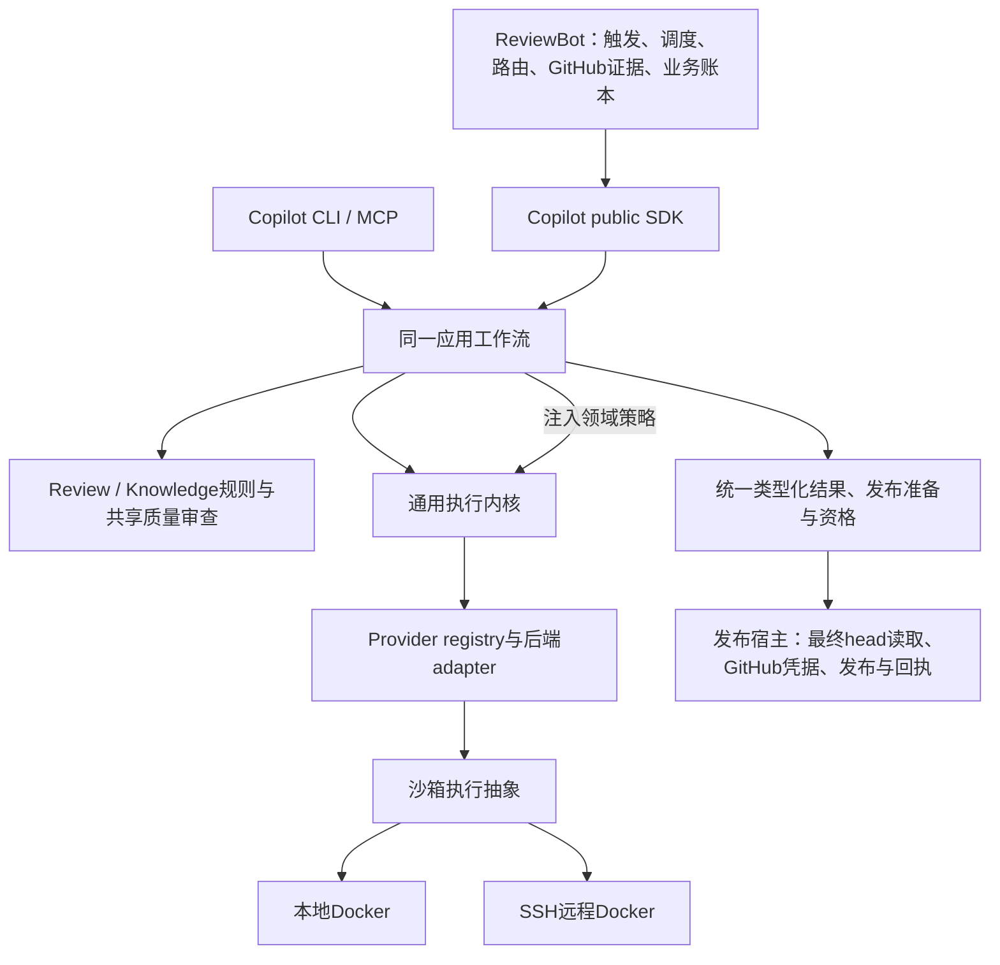

# 框架阶段最终交付 · 2026-10-17

> 当前交付入口：[立即收口交付](single-capability-framework-immediate-closeout.md)。下文保留7095历史范围。

> 此页保留7095／3bbf框架归档时的范围。后续发现的P0 generation防重连接见[当前修复及未迁移调用方](single-capability-history-extraction-checkpoint.md)：History已修复，Skeleton仍待迁移。下文0个连接不能解释为当前全部防重验收通过。

**框架阶段完成，完整目标保留并分阶段完成。** 本页为当前交付入口，取代较早候选的交付首页；历史报告保持原始范围。当前代码为 Copilot 7095／ReviewBot 3bbf，待接框架连接为空。本轮只收口必要验证、代码与文档，不启动新模型比较，不扩大修复范围。

| 能力归属 | 已迁移调用方 | 删除／保留边界 |
| --- | --- | --- |
| Copilot provider | review、knowledge、triage、owner routing | Bot vendor调用主体删除；兼容包装只转换与委托。 |
| Copilot review | Direct／Strict，local／remote，经ReviewRuntime | Bot runner与repair主体删除；旧Direct／Strict接口及strict_run_id保留兼容。统一head漂移拒绝。 |
| Copilot knowledge | init、intake、lifecycle、validator、Bot curation | 解析、约束、证据规范化、验证和有界curation共用；Bot knowledge_model.py、knowledge_curation_cycle.py删除。v1 append-only与lifecycle渲染合同保留。 |
| Copilot共享质量框架 | 各init阶段、Foundation owner／feature | 共用派发、修复、检查点和质量机制；各阶段验收策略保持独立。Foundation测试证据组装和证据模式选择主体去重，历史模板与Depth策略保留。 |
| Copilot应用组合／执行机制 | SDK／CLI／MCP、API／native、local／SSH | 内核领域逻辑改为注入；provider与沙箱执行位置分离。用量观察共用，领域预算账本不合并。 |
| Copilot预览完整性 | 缓存恢复、阶段串联、portable、history | 唯一preview读取／校验实现，删除portable独立校验循环；维护者新输入与已批准缓存采用明确策略，未知调用不换身份重派。 |
| ReviewBot业务与发布 | polling、assignment、admission、业务重试、发布对账 | 保留GitHub凭据、最终head读取、业务状态与发布回执。Copilot run、knowledge生命周期及预算各自保留权威。 |

[逐项机器清单](single-capability-framework-inventory.json)记录 **66项能力、28项删除条目、22个已闭环连接、0个待接框架连接**。条目包含所有者、调用方、删除符号和保留策略；“0”仅指框架连接，不表示完整验收结束。

## 当前代码与主流程结果

入口 → SDK → 应用工作流 → provider → 类型化结果 → 发布准备已贯通。当前7095／3bbf正常安装主流程补验及双仓源码边界检查见交付验证 (host-local path: `/data/zhoutaichang/copilot/output/single-capability-completion-20261012/framework-final-handoff-20261017/validation.json`)。模型及GitHub使用受控回复，不执行真实发布；正常安装无相邻产品src及源码路径注入，依赖复用。

当前Foundation修复的安装验证与精确wheel证明 (host-local path: `/data/zhoutaichang/copilot/output/single-capability-completion-20261012/foundation-generation-policy-20261017/result-selector.json`)通过：保持历史v3／v4／v5模板字节、旧unknown拒绝重派、checkpoint不改写、Depth范围、原生回执绑定、partial／portable和预算合同。当前安装选择217项零失败／错误／skip。它证明接线和兼容，不证明真实模型质量提高。

此前[81fb完整配对整合](single-capability-current-paired-81fb-integration.md)包含双仓完整套件、独立安装主流程、fresh最小消费者及实际Docker本地／SSH控制；源码4个环境skip有精确安装补验。该完整整合不重绑定为7095全量或原生验收。原始失败、补验、旧模型样本、标签和账本均保留。

## 可审阅、可运行交付

统一交付目录 (host-local path: `/data/zhoutaichang/copilot/output/single-capability-completion-20261012/framework-final-handoff-20261017`)包含双仓从原始HEAD生成的完整patch（含新增／删除）、当前wheel、架构／机器清单、验证命令和结果、代码身份与生产行数／AST统计。补丁各应用一次，不能再叠加历史overlay。目录内README记录运行方式与报告范围。

Copilot wheel SHA256：`70951ef63e138a2149c62dfbaa8f46a0b411f4c6c1522e26e17399c3400526d7`；Bot：`3bbf71df48a24eb05f6d07cb68fe145f8c2cd15b22f17a2f182dba4a7d001860`。当前修复相对81fb为3个生产文件、+49行／+78 AST节点；累计变化另见交付目录统计，净减行不是验收门槛。未commit、push、创建PR或部署。

## 后续优先级

| 优先级 | 后续工作与验收边界 |
| --- | --- |
| P1 真实质量 | 新冻结Codex比较、各init阶段与Review质量；验证知识解释完整性及运行provenance不混入可复用事实。旧Foundation案例未通过，不能由确定性测试替代。先Codex，其余vendor后验。 |
| P1 深层恢复 | 原unknown按原执行环境／身份对账；崩溃、并发、预算与发布回执结算矩阵。保留旧账本和闲置额度，不因未知响应再次付费派发。 |
| P2 机制细节 | 实际费用／served model、精细预算、各厂商认证、Docker认证完善与其他后端原生能力。unknown继续显式记录。 |
| 最终发布验收 | 最终精确配对全套／安装／质量shadow、release与pins、回滚、在途原环境保留或排空。框架交付不等于上线授权。 |

只将主流程断开、依赖越界或可能重复派发的问题作为即时修复项；其余按上表进入后续阶段，不再阻挡本次框架交付。
