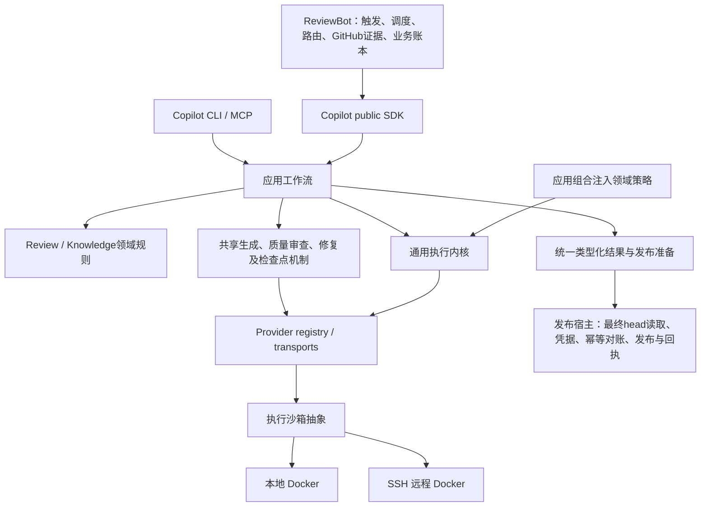

# 框架阶段最终交付 · 2026-10-17

> 最新统一交付入口：[框架阶段收口交付](single-capability-framework-closeout-20261017.md)。下文保留原6a8e冻结版本的范围；当前修复、41条删除记录及后续优先级以新入口为准。

框架阶段到此收口。Copilot／ReviewBot 的能力归属、调用方迁移和旧主体删除已形成可运行闭环；完整目标继续保留，后续质量、深层恢复和最终发布验收分别推进。本交付没有部署或真实 GitHub 发布，也没有新增真实模型调用。

## 架构与边界

SDK／CLI／MCP进入同一应用层。Docker执行机制与执行位置分离；本地和远程不各建业务循环。Bot业务账本／发布回执、Copilot runs、knowledge生命周期与领域预算各有权威，不合并成一份账本。

## 能力归属、调用方迁移与删除

| 唯一owner | 已迁移调用方 | 已删除的独立主体／保留的边界 |
|---|---|---|
| Copilot provider registry / transports | Bot review、knowledge、triage、owner routing | Bot vendor CLI、输出解析、模型修复主体删除；兼容runner仅委托。业务路由／fallback决策仍在Bot。 |
| Copilot ReviewRuntime / RunService | Direct／Strict、本地／远程、SDK／CLI／MCP | Bot Direct runner／repair执行主体删除，统一请求／类型化结果与durable run。Direct／Strict旧接口及strict_run_id兼容，provider_run_id通用。 |
| Copilot review领域与发布准备 | findings、dispositions、candidate、diff、Bot／standalone发布资格 | 重复recheck、diff解释、候选一致性及发布资格归一。head漂移拒绝发布；最终head和GitHub副作用留在宿主。 |
| Copilot knowledge / Curator | Bot curation、intake、lifecycle、portable validators | knowledge_model.py、knowledge_curation_cycle.py主体删除；规则解析、约束、证据、验证及有界curation归一。append-only字节合同与lifecycle渲染策略保留。 |
| Copilot共享质量框架 | 各init步骤、Foundation、Modules、History、Discovery、depth、curation生成 | 派发／修复／检查点／unknown处理共用。每步骤自己的schema、rubric和验收策略保留；机制一致不表示验收内容相同。 |
| Copilot进程监督与应用组合 | providers、validators、辅助命令、snapshot git、workers | 进程生命周期归一；内核移除knowledge／self-improvement依赖，应用注入领域策略。 |
| ReviewBot宿主适配 | polling、assignment、admission、业务重试、Git事务、publication及receipts | 只调用public SDK。保留GitHub业务状态、发布及宿主账本，不保留模型执行或修复循环。 |

[逐项机器清单](single-capability-framework-inventory.json)包含70项能力、37项删除记录和已闭环连接；删除记录包括函数内主体，不等同文件数。当前登记的框架未接连接为空。历史冻结清单保留原范围和条目数，不追改。

本次最后修复把curation原有内联native调用提取为唯一proposal入口，并让宿主使用现有共享checkpoint runner。init生成的pending判断也委托同一函数。ReviewBot在原业务账本保存检查点：未知结果拒绝替代调用，已知结果复用；明确未派发的失败保留业务重试上限。原输入／release改变时保留原检查点并拒绝新派发，等待原环境对账。生成→Git commit intent在同一次账本事务交接；部署和回滚检查拒绝不支持在途协议的版本。

## 可审阅与运行的代码

- 最终完整双仓补丁、wheels与验证包 (host-local path: `/data/zhoutaichang/copilot/output/single-capability-completion-20261012/curation-generation-recovery-20261017T083812Z/framework-final-review.tar.gz`)
- 代码身份及补丁重建证明 (host-local path: `/data/zhoutaichang/copilot/output/single-capability-completion-20261012/curation-generation-recovery-20261017T083812Z/code-identity.json`)
- 归属／迁移／删除清单快照 (host-local path: `/data/zhoutaichang/copilot/output/single-capability-completion-20261012/curation-generation-recovery-20261017T083812Z/ownership-migration-deletion.json`)
- 主流程与必要验证结果 (host-local path: `/data/zhoutaichang/copilot/output/single-capability-completion-20261012/curation-generation-recovery-20261017T083812Z/framework-result.json`)

完整binary patches分别相对Copilot `647e6e02`／ReviewBot `1e70e983`应用一次，包含新增和删除；不能叠加到已有变更树。工作树见Copilot (host-local path: `/data/zhoutaichang/copilot/wt-copilot-single-capability-20261012`)／ReviewBot (host-local path: `/data/zhoutaichang/copilot/wt-reviewbot-single-capability-20261012`)。未commit、push、创建PR或部署。

当前wheels SHA256：Copilot `6a8e3339ba48cce5337b7e2ff9a497ed39bbd0420a534d773bbee4bb293ffc16`；Bot `2db4f086ebc5549ff9ad4c11e6d9402679f7524e0171c8dee775d69fe21d8175`。正常安装后2337／129个产品成员与wheel及源码匹配。安装测试移出源码目录，以`-I`运行且清除PYTHONPATH／PYTHONHOME；依赖复用，不称本次fresh最小安装。

## 主流程结果与验证范围

入口→SDK→应用工作流→provider→类型化结果→发布准备已贯通，覆盖Direct／Strict、local／remote、stale-head拒绝及原身份防重。Bot public-SDK-only、领域不依赖SDK／transport、执行内核不依赖领域的边界验证通过。

本次安装主流程：Copilot 138项通过；Strict 16项因运行器漏复制playbook fixture最初报错，补齐fixture后16项通过。Bot 205项通过。源码SDK94项、共享质量／init与依赖边界87项、Bot knowledge72项通过。宿主恢复／边界／release相关80项的首次最后运行有1项部署能力清单不同步；修正后该用例及协议门禁已单独复验，详见framework-result.json和原始JUnit。数量只界定验证范围，不表示整体完成度。

当前修复验证了真实进程退出后的未知派发阻断、耐久结果复用、已知未派发的有界重试、上游输入漂移拒绝、生成与Git提交交接，以及部署／回滚协议拒绝。所有模型和GitHub响应受控，没有真实模型质量结论。

[此前精确配对整合](single-capability-paired-recovery-integration-20261017.md)保留原749a／41cc全套、fresh安装和Personal-Agent实际Docker证据。本次不冒充当前wheels的全量或远端重验；该次Docker absolute原探针失败及原容器成功对账分别保留。所有本次负例、运行器错误和修复前失败日志均保留。

本次修复src Python：Copilot6文件净+146行／+1065 AST节点，Bot2文件净+96行／+820 AST节点。deploy shell／schema／release scripts单独列出；累计src生产变化及逐文件统计见包内production-delta.json。包含之前保留工作，净减行不是门槛。

## 后续优先级与完整目标

| 优先级 | 后续交付与验收条件 |
|---|---|
| P1 真实模型质量 | 当前冻结版本的Direct／Strict及各init整例比较。保留History／Foundation已有失败；提取正确、fixture通过不等于最终知识质量通过。独立模型家族要求仍保留，其他vendor按用户决定后验。 |
| P1 深层恢复与在途保留 | 深层崩溃／并发、精细预算和回执结算。原unknown只按原run／执行位置／版本／profile对账；不自动替代付费派发。SIGKILL时SDK写入的自主修复、原生产在途环境排空仍需后续验收。 |
| P2 后端与运行环境 | Claude／Cursor／DeepSeek等原生矩阵、认证差异、Docker认证完善、served-model与实际费用缺失；未知值不伪填。 |
| 发布前验收 | 最终不可变配对releases／pins、最终全套、受控shadow、在途保留或排空、rollout与回滚。框架交付不代表上线批准。 |

[完整完成计划](single-capability-completion-plan.md)继续有效；框架阶段已交付，完整目标及发布状态仍未完成。不再以这些后续项阻挡本阶段交付。
