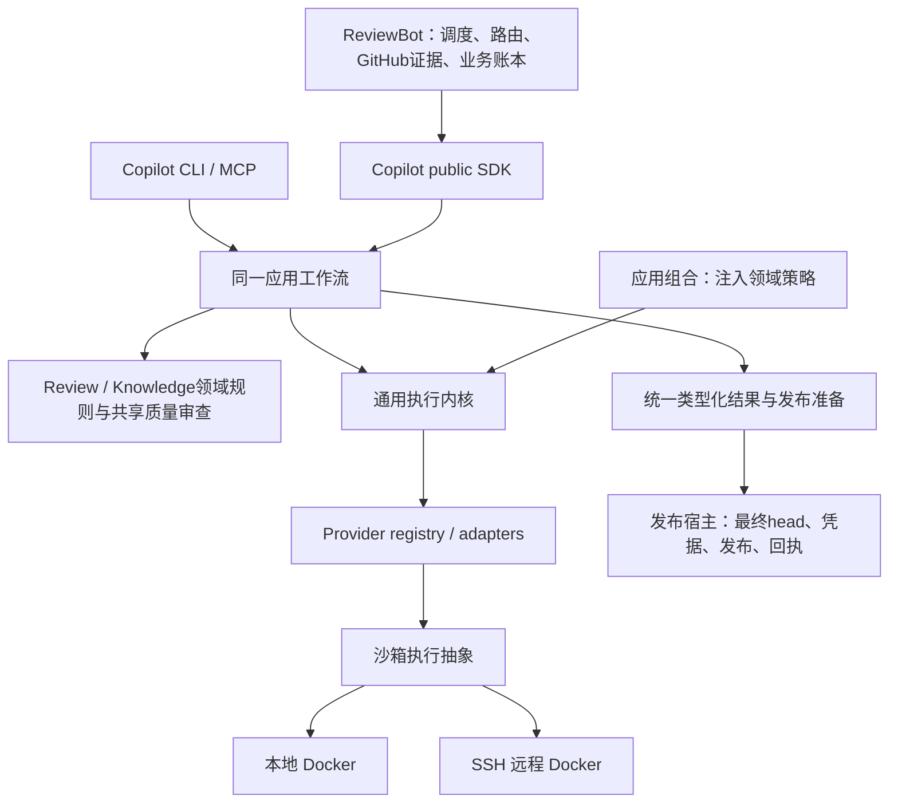

# 框架阶段交付 · 2026-10-18

框架阶段现已收口。当前交付配对为 Copilot `a10c3484…`／ReviewBot `24ac7cfb…`；完整重构目标保留，后续分阶段完成。本页是当前统一交付入口，历史报告仍只代表其原始版本。

## 最终架构

Bot jobs／发布回执、Copilot runs、knowledge生命周期与领域预算分别保留权威。Docker机制通过执行抽象供本地和SSH远端共用，位置选择不另建业务循环。

## 能力归属、调用方迁移与旧实现删除

| 唯一归属 | 已迁移调用方 | 已删除主体／保留边界 |
| --- | --- | --- |
| Copilot providers／进程监督 | review、knowledge、triage、owner routing、validator、辅助命令 | Bot vendor CLI调用及解析主体、重复进程机制删除；兼容runner只转换与委托。执行策略绑定工具、凭据、schema、resume和deadline。 |
| Copilot ReviewRuntime／RunService | Direct／Strict、local／remote、SDK／CLI／MCP | Bot Direct runner／repair主体删除；统一请求、结果和持久run；旧Direct／Strict入口及strict_run_id保留委托兼容，provider_run_id为通用身份。 |
| Copilot review规则／发布准备 | findings、discussions、diff、candidate、Bot及standalone | recheck、disposition、diff index和发布资格共用；head漂移拒绝发布；最终head读取与GitHub effect仍属发布宿主。 |
| Copilot knowledge／Curator | init、intake、lifecycle、portable validators、Bot curation | 解析、ID／容量、证据规范化、验证和有界curation统一；Bot knowledge_model.py、knowledge_curation_cycle.py删除。append-only字节合同和lifecycle渲染策略保留。 |
| Copilot共享质量审查／generation | 各init步骤、Foundation、Modules、History、Discovery、depth | 派发、修复、检查点及unknown机制共用；各自机制循环删除。各步骤的schema、rubric、验收规则和领域预算继续独立。 |
| Copilot应用组合／执行抽象 | SDK／CLI／MCP、native／API、local／SSH | 执行内核的knowledge／self-improvement业务依赖移出，由应用注入；不按执行位置复制工作流。 |
| ReviewBot业务与发布 | polling、assignment、admission、fallback、业务重试、发布与对账 | 保留GitHub业务策略、凭据与回执。marker查询共用；只读GitHub transport迁到github_client，旧remote路径只保留同对象alias。原回执对账不重算、不POST。 |

[逐项机器清单](single-capability-framework-inventory.json)：**70项能力、41项原始删除记录、24个已闭环连接、0个登记的未接框架连接**。每项列owner／callers；删除记录列路径和符号，包含文件内主体，不能解释为41个文件。后续marker／只读transport迁移记录在相应能力条目内，不通过增加数字表示进度。

## 可审阅、可运行代码

- 完整双仓补丁、精确 wheels、相关测试和运行证据 (host-local path: `/data/zhoutaichang/copilot/output/single-capability-completion-20261012/session-deadline-delivery-20261017/session-deadline-review.tar.gz`)。SHA256 `6544d3644c4706fc4ffab5395c781d67e604d4454eb1ec0fc34f0b1009119d5c`。
- 代码身份、基线及冻结树 (host-local path: `/data/zhoutaichang/copilot/output/single-capability-completion-20261012/session-deadline-delivery-20261017/code-identity.json`)。两个 full patch 分别对 Copilot `647e6e02`／ReviewBot `1e70e983`应用一次，不能叠加旧 full patch。精确 wheels 在代码包内。
- 最后的评测账本修复及回归证据 (host-local path: `/data/zhoutaichang/copilot/output/single-capability-completion-20261012/a10-retained-budget-guard-20261018/a10-retained-budget-manifest-review.tar.gz`)：声明 retained allowance 时，在建库／建 stage 前校验保留额度与新增双臂上限。该增量只改 eval，不需要重建产品 wheel。
- 可审阅工作树：Copilot (host-local path: `/data/zhoutaichang/copilot/wt-copilot-single-capability-20261012`)、ReviewBot (host-local path: `/data/zhoutaichang/copilot/wt-reviewbot-single-capability-20261012`)。未 commit、push、创建 PR 或部署。

生产修复行数／AST (host-local path: `/data/zhoutaichang/copilot/output/single-capability-completion-20261012/session-deadline-delivery-20261017/product-delta.json`)保留原累计／切片范围；最近 session deadline 修复相对 e98e 为净 +8 行／+47 AST。随后预算修复生产增量为 0，eval ledger 净 +10 行／+111 AST。本次收口仅文档与证据更新，生产增量 0。净减行不作为验收门槛。

## 主流程与必要验证结果

**入口 → public SDK → 应用工作流 → provider → 类型化结果 → 发布准备已贯通。** Direct／Strict、local／remote 使用统一请求与结果；SDK／CLI／MCP进入同一应用层。各 init 共享质量执行框架，保留各自 schema、rubric、验收策略和领域预算。主流程中的模型／GitHub effect 使用受控边界回复；这不代表真实模型质量或真实发布验收。

- [当前精确配对完整整合](single-capability-a10-full-paired-integration-20261018.md)：Copilot 6013 passed、4 个环境 skip；当前安装环境对应 namespace／资源补验 5 passed。ReviewBot 2925 passed、0 skip。原两个完整进程 exit 0。保留原 skip，不改写为未发生。
- 安装核对：当前 wheel 的 Copilot 2337、Bot 130 个产品成员逐字节匹配；安装核对无源码路径注入。测试依赖复用，不称 fresh-install 验收。
- [当前 session 修复](single-capability-session-deadline-delivery-20261017.md)：同一完整 PR5636／source／host／knowledge 输入通过本地与 SSH Docker 的生产 session 准备、Codex 配置和受限 bridge 检查。未缩小输入，未进入模型派发。
- stale-head 拒绝及原回执结算已有[确定性证据](single-capability-publication-original-reconciliation-20261017.md)：已接受／丢响应后即使 head 漂移，仍结算原 effect，不重新生成或 POST。
- 本次最后必要补验：依赖边界 24 项＋评测 ledger／coordinator 100 项，共 124 passed、0 failure／error／skip。JUnit (host-local path: `/data/zhoutaichang/copilot/output/single-capability-completion-20261012/framework-handoff-20261018-final-checks.xml`)。命令：`python -m pytest -q test/test_capability_ownership.py test/test_step_registration_boundary.py eval/single-capability-shadow/test_ledger.py eval/single-capability-shadow/test_run_paired.py`。
- 交付归档身份核对 (host-local path: `/data/zhoutaichang/copilot/output/single-capability-completion-20261012/framework-final-handoff-20261018/artifact-verification.json`)：当前代码、完整整合及最后 eval 修复包 SHA256 一致。没有因收口重跑完整套件或扩大实验。

框架当前缺少的已登记连接为 0；清单中尚未删除的框架重复主体为 0。兼容入口只保留转换／委托；未来发现的边界回归继续修复，不以本次登记范围断言不存在任何未知缺陷。

## 后续优先级：不阻挡本次框架交付

| 优先级 | 后续事项与完成条件 |
| --- | --- |
| P1 真实模型质量 | 冻结整例 source／knowledge／schema／独立标签及有效 profile 后再比较；当前准备与源码 oracle 不算质量通过。先 Codex，其他后端后验。Discovery／Module-card 保留独立 family 策略。 |
| P1 原未决身份与防重复派发 | Strict 新草案仍与旧 reserved 调用共用 PR1／head `807139…`，业务 run 为 interrupted 不代表 native 费用已结算。草案保持不可派发；后续先核对原身份，或显式建立独立新案例，不能只换实验 ID 重发。Discovery unknown、History 外层 ack 及原执行环境继续保留。 |
| P1 深层恢复及预算对账 | 补崩溃、并发、终态／回执结算矩阵，明确未知费用。当前保守上限 519 与 spare 不动；182 次只是未分配提案，预算校验拒绝草案，不授权新的 701 上限。 |
| P2 认证与后端细节 | Docker 本地／SSH 抽象已接通；进一步完善凭据与 proxy 生命周期、服务端认证、served model、实际费用及其他厂商原生验收。临时认证／TLS 控制已关闭，不当成可持续 live 环境。 |
| 发布前验收 | 最终不可变配对、consumer pins、受控 shadow、在途盘点、原环境保留／排空、rollout／rollback。框架交付不等于可直接部署。 |

PR-history 耐久执行继续要求显式 payload 留存，默认省略在派发前拒绝。未新增模型调用、未改原 paid unknown／预算账本。后续只把主流程断开、依赖越界或可能重复派发作为立即修复事项；其余按此清单分阶段处理。[完整计划](single-capability-completion-plan.md)要求正文保持不变。
