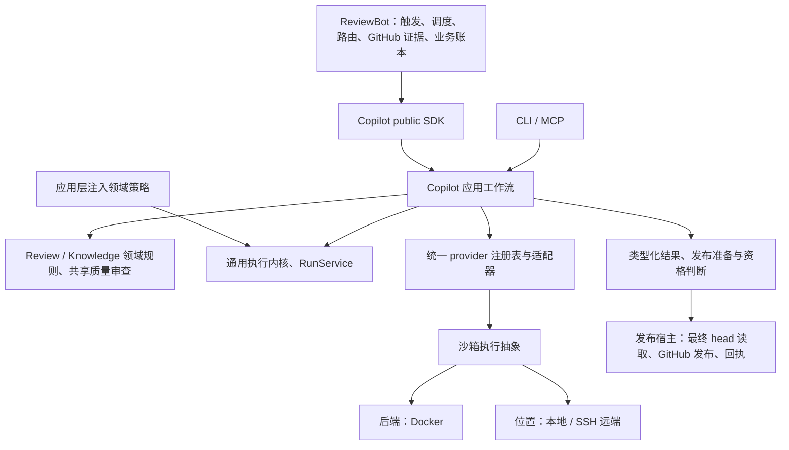

# 框架阶段交付（2026-10-16）

当前唯一交付入口为 [框架阶段正式收口](single-capability-framework-stage-acceptance.md)：架构、清单、当前6629/B939代码、必要验证及后续优先级已汇总。下文各历史候选与补充仍保留原验证范围，不作为当前最终包的全量证明。

当前整合候选及验证范围见 [worker 连接与整合交付](single-capability-worker-cleanup-frames.md)。完整双仓补丁已包含全部后续切片，无需叠加旧 overlay；精确 wheel 为 `3f272fc392f9df696699fc043f593d744af63e5e597743bdc3d59ac8f9649225`。双仓全量核验另行运行，未宣称最终发布通过。

本次交付完成能力归属、调用方迁移、旧实现删除及可运行主流程。完整目标继续由 [completion plan](single-capability-completion-plan.md) 约束；真实模型质量、深层恢复和发布验收单独分阶段完成。本交付不代表允许上线。

SDK／CLI／MCP 进入同一应用层；执行内核通过注入获得领域策略。Docker 后端与执行位置独立配置。业务任务、Copilot run、knowledge 状态和预算账本各保留权威。

| 能力 | 唯一归属 | 已迁移调用方 | 旧实现处理 |
| --- | --- | --- | --- |
| Provider、进程、事件、结构化完成 | Copilot registry / adapters / shared process | Bot review、knowledge、triage、owner routing | 删除 Bot vendor 调用与模型修复循环；包装只转换并委托 |
| Direct / Strict 持久执行 | Copilot ReviewRuntime、RunService、应用工作流 | Bot local / remote，SDK / CLI / MCP | 统一请求、结果、provider_run_id；兼容 strict_run_id |
| Finding、discussion、diff、candidate、发布资格 | Copilot review domain | 两种模式及发布宿主 | 删除重复规则主体；head 漂移拒绝发布 |
| Knowledge 类型、解析、ID、约束、证据、验证 | Copilot neutral contracts / knowledge domain | init、curation、lifecycle、intake、便携校验器 | SDK 导出与命令包装委托 canonical 实现 |
| 有界 curation | Copilot KnowledgeCurator.curate | Bot knowledge adapter | 删除 knowledge_model.py、knowledge_curation_cycle.py；导出和恢复留在 Bot |
| Init 质量审查 | Copilot quality_review / 应用组合 | foundation、depth、discovery、history、maintenance 等 | 一个派发／修复／验证／检查点机制，各步骤保留验收策略 |
| 调度、路由、GitHub 状态、发布、回执 | ReviewBot／发布宿主 | scheduler / publisher | 保留业务权威；执行完成不代替发布回执 |

逐文件／符号清单见 [inventory](single-capability-framework-inventory.json)，详细调用关系与 init 策略见 [delivery map](single-capability-framework-delivery.md)。清单同时记录保留的兼容包装，不能保留独立业务循环。

最后收口修复包括：状态轮询锁不再污染不可变输入快照；quick-map 规则不再把整个 owner 范围当作源码证据；Direct 未决模型结果保留 interrupted，经 SDK 进入 Bot 后保持 pending；MoA 首次调用和 retry 遇到未决原生调用或禁止 fallback 的错误时，不再切换模型。后两项没有新增业务循环或改动 Bot 发布策略。

验证结果、精确 wheel 身份及可复现命令见本目录 [closeout result](single-capability-framework-closeout.md)。历史完整源码／namespace 报告保持原身份，最后修复另有当前源码和安装包验证，不冒用旧报告。

当前可审阅代码位于 `/data/zhoutaichang/copilot/wt-copilot-single-capability-20261012` 与 `/data/zhoutaichang/copilot/wt-reviewbot-single-capability-20261012`。HEAD 仍为原始基线 647e6e02 / 1e70e983；交付补丁包含新增、修改和删除，不以旧 HEAD 代表当前实现。未 commit、push、改 pin、发布或部署。

| 后续优先级 | 完成条件 |
| --- | --- |
| P1：超时子进程清理 | 当前安装包 policy 整组一次失败、定向复核通过；保留原始失败，查明并消除进程清理不稳定性，不以重跑通过关闭。 |
| P1：上线前恢复安全 | 完成 Strict／其他组合路径中未决事实到持久状态的端到端审计，以及原 Strict／Discovery 未知结果的原身份对账；不能把终端失败状态或本地退出码作为替代付费派发的授权。保留原环境、版本、profile、业务键与账本。 |
| P1：真实模型质量 | 补齐 Direct／Strict、foundation、history、screening 等冻结比较；保留已有拒绝样本。Strict depth 已通过一个冻结案例，不能推导整体质量通过。Codex 优先，其他后端后验。 |
| P2：深层恢复与对账 | 崩溃、预算／实际用量、并发、发布回执结算矩阵；unknown 不当作零，不因状态不明重新派发。 |
| P2：后端与认证 | 其他厂商原生验收、served identity、Docker 凭据、取消／resume／partial output；不广告未经验证的能力。 |
| P2：知识产物质量 | 生成链接、foundation 覆盖、规则候选与语义质量；重生成产物重新校验，不复用旧语义回执。 |
| 发布阶段 | 审阅实际提交、配对 release／pin、回滚及保留／排空旧环境；另行验收。 |

框架连接和重复主体迁移已收口；上述验收缺口如实保留。后续只有阻断主流程、破坏边界或可能重复派发的问题进入即时修复，其余按阶段交付。

后续 P1 handler 未决状态切片已完成源码和精确新 wheel 的定向验收：[共享结果补充](single-capability-shared-pending-outcome.md)。Direct／Strict／MoA 复用判断，Bot 保持 pending；原框架包与失败 gate 不变。更深恢复和超时子进程问题仍保留。

后续进程清理 P1 的两项稳定复现已修复并通过源码／新 wheel 定向验收：[结算补充](single-capability-process-exit-settlement.md)。原 policy 失败报告不改写，完整清理矩阵与真实 survivor 状态传播仍待验收。

真实 survivor 的运行期传播已通过源码／精确新 wheel 验证：[传播补充](single-capability-process-survivor-propagation.md)。待对账错误保留部分输出／身份，模型不 fallback，Direct／Strict 保持 interrupted；跨崩溃持久化和完整恢复仍开放。

清理诊断已复用既有 trace/attempt 持久保存，原门禁在新解释器中拒绝投影 pending：[诊断补充](single-capability-durable-cleanup-evidence.md)。inner worker 帧携带及完整恢复仍待验收；旧交付和原账本不变。

当前3f27/B939 的双仓源码与七组安装集成均已终态完成，无失败／错误／源码测试漂移；源码三项环境 skips 有逐项同字节补验，原 strict no-skip gate 仍为 false。闭环见 `integration-worker-cleanup-closure-20261016/result.json`，不构成完整质量／恢复／发布验收。

恢复写入前的 pending／损坏事实拒绝与共享 receipt 禁止 fallback 已补齐，当前定向验收见 [恢复补充](single-capability-native-recovery-refusal.md)；不改写上一整合候选的全量证明。
