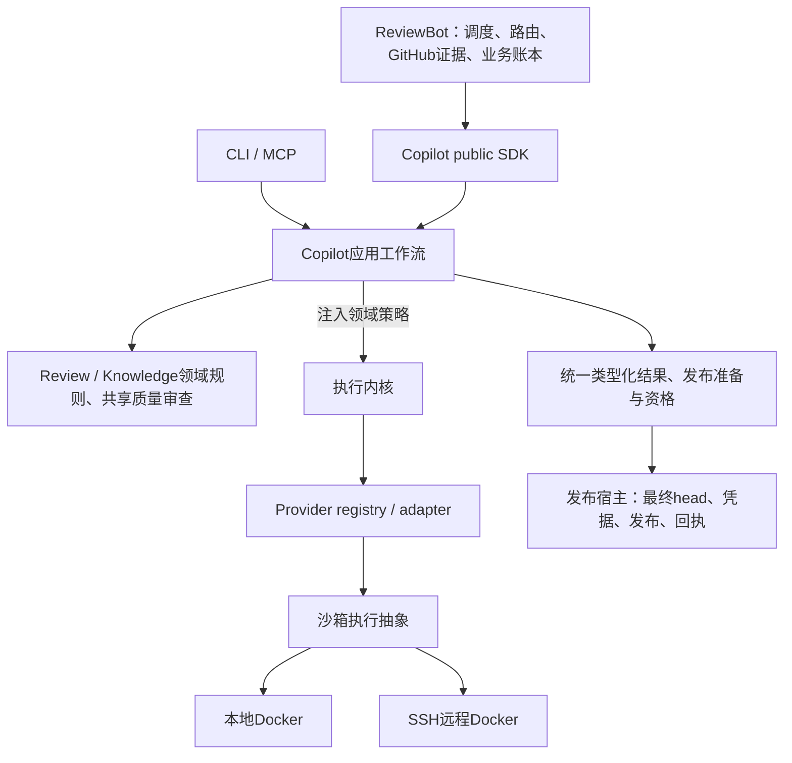

# 框架阶段收口交付 · 2026-10-17

> 此页保留401dbd框架封存范围。后续完整整合发现的工作流策略绑定缺口及已验证修复见[generation边界补正](single-capability-generation-workflow-policy.md)；完整验收仍开放。

框架阶段完成；完整目标保留并分阶段验收。本页为当前唯一交付入口，早期归档报告保留各自版本范围。当前没有已知待接框架连接或未迁移的独立派发主体。

| 归属／能力 | 已迁移调用方 | 旧实现删除／保留策略 |
|---|---|---|
| Copilot provider | review、knowledge、triage、owner routing | Bot vendor调用主体删除；兼容层只转换与委托。 |
| Copilot review | Direct／Strict、local／remote经ReviewRuntime | Bot runner／repair主体删除；旧API及strict_run_id兼容；统一head漂移拒绝。 |
| Copilot knowledge | init、intake、lifecycle、validator、Bot curation | 共用解析、约束、证据、验证与有界curation；Bot knowledge_model.py和knowledge_curation_cycle.py删除。保留两种渲染合同。 |
| Copilot共享质量审查 | 各init阶段、Foundation owner／feature | 共用机制、各自验收策略；不合并业务预算或生命周期权威。 |
| Copilot generation检查点 | Skeleton map、通用rules／Deepen、Modules card、History extraction | 删除直接generate主体及History独立派发包装，进入init_generation→checkpoint_review。Foundation、Discovery、Depth保留已有任务日志权威。旧History日志只读适配，不另行派发。 |
| 应用组合／沙箱 | SDK／CLI／MCP、API／native、本地／SSH | 内核不导入领域策略；执行位置与provider分离。 |
| ReviewBot业务／发布 | polling、assignment、admission、业务重试、发布对账 | 保留GitHub凭据、最终head、业务状态和发布回执；独立账本不合并。 |

逐项能力、调用方和删除符号见[机器清单](single-capability-framework-inventory.json)。当前generation修复保存派发意图与结果，拒绝unknown重派和旧无意图的含糊状态；已知派发前拒绝可重试，缓存结果与调用方修改隔离。业务coverage刷新保留执行日志。未修改历史unknown或启动新付费比较。

## 主流程与代码

交付目录 (host-local path: `/data/zhoutaichang/copilot/output/single-capability-completion-20261012/shared-generation-checkpoint-20261017`)包含双仓完整patch（含新增／删除）、正常安装wheel、源码／wheel身份、生产行数与AST变化、验证命令及日志。入口→SDK→应用→provider→类型化结果→发布准备通过受控回复贯通；Direct／Strict、本地／远程和stale-head拒绝一并验证。无真实GitHub发布。

当前修复相对b333涉及10个生产文件，净+127行／+753个AST节点；累计相对原始HEAD统计另附，净减行不作为验收门槛。

当前修复的阶段主流程、共享质量检查点、旧History状态兼容、未知调用恢复不重派及缓存隔离验证通过；双仓依赖边界通过。正常安装测试不注入产品src，依赖复用，不能称fresh最小环境。精确结果见交付目录validation.json和result-selector.json。

完整双仓套件及实际Docker本地／SSH控制沿用[81fb配对整合](single-capability-current-paired-81fb-integration.md)的原始范围；本次运行必要受影响验证，不重绑定为当前版本全套或真实质量证明。原始失败日志保留。

## 后续优先级

| 优先级 | 后续项／完成标准 |
|---|---|
| P1 真实Codex质量 | Foundation冲突／失败不变量完整性、History普通component与model scope区分及各init质量；已有整例未通过，不以确定性测试代替。冻结新比较后再评估。 |
| P1 深层恢复 | 崩溃窗口、并发写入、预算与发布回执结算矩阵；旧unknown仅在原环境按原身份对账，禁止替代付费派发。 |
| P2 后端与机制细节 | 其他vendor原生验收、认证差异、Docker认证完善、served model和精细费用／预算。先Codex，其余后验。 |
| 发布前最终验收 | 精确配对全套、安装与shadow、release／pins、回滚、在途原环境保留或排空。框架完成不代表发布验收通过。 |

只有主流程断开、依赖越界或重复派发风险立即修复；其余不阻挡本次框架交付。未commit、push或部署。完整目标未标记完成。
