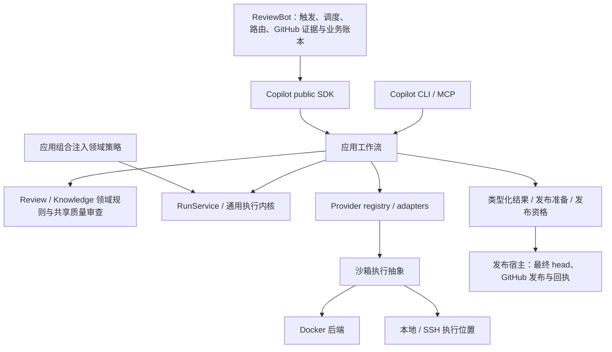

# 框架阶段正式交付（2026-10-17）

框架阶段完成，完整重构目标保留。当前交付停止扩大验证范围：真实模型质量、深层恢复及其他后端原生验收进入后续阶段，不再阻挡框架代码审阅和运行。本页覆盖此前交付入口的“当前版本”描述；历史报告及归档包保持原版本与原结论。

框架后的当前源码候选为e3eb／3bbf，独立修改和验证见[review严重度归属](single-capability-review-severity.md)。下文“当前”指封存的框架交付23a5，不代表后续候选已通过同一全量或镜像验收。

## 架构与能力归属

| 唯一归属 | 已迁移调用方 | 删除／保留边界 |
| --- | --- | --- |
| Copilot provider | Bot review、knowledge、triage、owner routing → public SDK | 删除 Bot vendor 调用及独立模型修复主体；包装只转换和委托。 |
| Copilot review | Direct／Strict、local／remote → 统一请求、持久 run 和类型化结果 | Bot 旧 runner／repair 主体删除；provider_run_id 与 strict_run_id 兼容。head 漂移统一拒绝发布。 |
| Copilot knowledge | init、lifecycle、intake、便携验证器、Bot curation | canonical 类型／解析／证据／验证及有界 curation；Bot knowledge_model.py、knowledge_curation_cycle.py 删除，保留宿主导出与恢复。 |
| Copilot 共享质量机制 | 各 init 阶段和质量调用 | 共享派发、修复、校验和检查点，各步骤保留自己的验收策略；共用机制不等于验收标准相同。 |
| Copilot 应用组合 | SDK／CLI／MCP | 统一应用入口；领域策略由组合层注入，通用内核不依赖 knowledge／self-improvement 业务。 |
| ReviewBot 业务与发布 | polling、admission、routing、GitHub、publisher | 保留业务重试、最终 head 读取、发布对账与回执。Bot job、Copilot run、knowledge 状态和预算账本各有权威。 |
| Copilot 沙箱机制 | 本地与远程 provider 执行 | Docker 后端与本地／SSH 位置分离；保留工具、凭据、超时和不重复派发策略。 |

[机器清单](single-capability-framework-inventory.json)逐项列出 **64 项能力、24 项删除条目、22 个已闭环连接、0 个待接框架连接**，包括具体路径、移除符号及兼容包装。旧实现删除不是仅按文件数量判断：保留兼容文件的主体也已改为委托。详细历史映射见 [delivery map](single-capability-framework-delivery.md)，版本身份以本页和原始结果为准。

## 可审阅、可运行代码

工作区：`/data/zhoutaichang/copilot/wt-copilot-single-capability-20261012`、`/data/zhoutaichang/copilot/wt-reviewbot-single-capability-20261012`。

当前精确 wheel：Copilot `23a547fe054b2b2c17dac99991421d456af601d1e467399de57cd75ac5b62352`；ReviewBot `3bbf71df48a24eb05f6d07cb68fe145f8c2cd15b22f17a2f182dba4a7d001860`。

最终包：`/data/zhoutaichang/copilot/output/single-capability-completion-20261012/framework-closeout-current-20261017/framework-current-review.tar.gz`。包含从 Copilot `647e6e02`／ReviewBot `1e70e983` 一次重建的完整双仓补丁（含新增文件）、重建校验、wheels、架构／迁移／删除清单、必要验证及明确版本的既有主流程证据。无需叠加历史 overlay。README 提供应用、安装和检查命令。生产行数／AST 增减单列，包含先前保留改动；总量减少不是交付门槛。

## 主流程及最后修复验证

入口 → SDK → 应用工作流 → provider → 类型化结果 → 发布准备已贯通。受控模型／GitHub 边界验证 Direct／Strict、local／remote、head 漂移拒绝、发布中断后对账和禁止重复派发；本次不做真实发布。

本次必要验证覆盖：共享 dispatch 的 API／CLI 路径与格式修复、显式非成功结果仍拒收、Direct／Strict、知识 manifest 完整性、公共 SDK 与依赖边界、Bot 发布进程／工作流恢复及远程宿主。当前源码检查128项、Bot107项、安装包检查61项均零失败、零跳过。最终机器结果见包内 `result.json`，原始 JUnit 与日志分别保留。

最后生产变化相对已完整验证的 Copilot `292e37b6` 仅两处：共享 dispatch 定义任务完成状态指引，格式修复复用同一指引。没有修改状态枚举、失败接受条件或 finding recheck gate。首次新增测试的 harness fixture 缺少必填参数，修正后重跑；初始失败证据保留，不当作产品通过。系统 Python 缺 build backend 的失败也保留，最终隔离构建成功。

既有 `292e37b6`／`3bbf71df` 独立整合：Copilot 完整源码套件零失败、三个环境 skip 有同候选安装资源／实际 namespace 补验；Bot 完整套件、安装 evaluation、最小无 MCP 消费者和 SDK 检查通过。真实 Docker 本地／SSH stdio 验证正常读取及篡改拒绝；更早精确候选已验证 complete／idle／absolute／cancel、原结果回读及重复派发拒绝。这些证据保持原 wheel／image 身份，**不是当前23a5的新全量或新镜像验收**。见 [292e整合](single-capability-bridge-knowledge-integrity.md)及包内独立归档。

## 后续清单（不阻挡框架交付）

| 优先级 | 剩余工作与验收界限 |
| --- | --- |
| P1 质量 | Codex 冻结真实质量比较覆盖 review 与各 knowledge 阶段。最近 Strict 双侧均找到核心缺陷，但 carried recheck 的任务状态造成 typed 完整性失败，严重度／引用亦有缺口；保留失败样本，不用工作流 done 冒充质量通过。当前状态指引尚未重新做真实模型质量验证。 |
| P1 恢复，上线前 | 原未知执行依原身份对账；补深层崩溃、并发与回执结算矩阵。不重置旧账本、不替换未知付费调用。已有主流程防重检查继续生效。 |
| P2 | 精细预算及实际用量对账、served model 可观测性、厂商认证差异、Docker 认证完善、其他后端原生验收与完整进程控制矩阵。按用户决定先 Codex。 |
| 发布阶段 | 当前代码审阅、配对 release／pin、回滚、在途原环境保留或排空、部署验收及完整最终门禁。 |

后续若发现主流程断开、边界破坏或可能重复派发，立即修复。其余统一进入上述阶段。本次零新增模型调用；未 commit、push、修改 release pin、发布或部署；完整目标不标记完成。

后续当前e3eb／3bbf已有独立完整配对整合和限定Strict比较，见[single-capability-review-policy-integration.md](single-capability-review-policy-integration.md)。该证明不改写框架23a5或历史292e报告，余下knowledge质量、恢复、其他后端及发布门禁仍开放。
