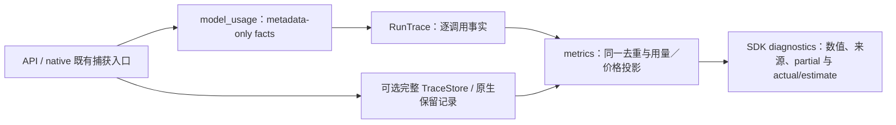

# 模型用量投影单一归属（框架后切片）

当前候选Copilot `26bd3c72dd73e4c791937b7c06317134cc2527655d447b71619cb3424176a7bc`，Bot3bbf不变。修复e3eb真实Strict比较观察到的promotion用量遗漏；旧e3eb整合、质量样本及其结果保持原字节，不重绑定为新候选全量／原生验收。

## 反例与完整范围

旧SDK诊断576236−13538=562698 input、20760−52=20708 output，恰好少一次coverage promotion调用。native账本和调用上限已包含它；遗漏发生在SDK统计投影。另有同类直接调用：格式修复、质量评估等。只在promotion加一条计数会继续留下这些缺口。

默认API的TRACE_STORE_ROOT为空，完整请求记录是可选的，不能为补计数偷偷开启正文留存。因此在既有模型捕获入口投影只含身份／用量的事实，由执行器统一注入观察上下文；完整记录可选，metadata不含system、messages、reply或工具正文。

## 归属、调用方及删除

| 所有者 | 调用关系与删除结果 |
| --- | --- |
| model_usage.py | 定义唯一metadata事实形状和有界观察上下文；API capture_model_call（包括未启用正文记录）及native TraceStore model_call捕获委托。读取模型请求或生成重试不在本模块。 |
| engine/executor.py | 统一绑定run上下文，asyncio线程继承；不导入review／knowledge／improvement业务策略。没有为各step单独加计数。 |
| metrics.py | 逐调用事实及保留记录按run_id归属、native_attempt_id／record id去重；一个用量／价格归约实现。旧span独立定价／汇总主体删除，改为转换后委托；旧events仅作无事实时的明确兼容读取，不叠加重计。 |
| execution_artifacts.py | 唯一native-session位置／trace root选择，session_execution旧内联目录hash主体删除；快照排除引用同一目录常量。 |
| contract.py | 保留原四个cost字段，透传来源、unknown／partial、实际模型费用与估算等可选诊断，旧四字段记录形状仍可读取。 |

模型调用／校验逻辑未修改；quota、domain budget、native journals和业务幂等性仍由原所有者负责。metadata ID不参与派发，不创建新付费身份。此投影不结算预算、不修复或重派unknown。PR-history耐久执行仍要求显式正文留存；metadata-only不绕过其默认拒绝。

## 行为与验证

- API正文留存开／关都覆盖真实LLM归一化路径，底层API回复为受控替身；错误JSON和已付费模型身份不匹配仍保留用量。默认关闭完整留存时未新增API请求／回复blob。
- Engine线程上下文自动注入，checkpoint恢复不再调用模型，也不重复累计。恢复读取的原生记录与metadata镜像按原身份去重；不同API调用不因复用provider request id被误合并。
- 诊断写入失败、开始marker缺失、正文capture失败、未知用量、冲突镜像及损坏journal明确partial／unknown，不触发模型重试，不报告完整零费用。无run归属的旧baseline保留兼容来源，不凭目录位置猜测关系。
- reported zero cost保留；未知模型价格不使用默认价格假装真实支出。actual_model_usd是报告的模型费用，actual_usd在CI等实际费用未知时仍unknown；usd可为估算／已知小计并附标志。
- 只读重投影原candidate七个完成回执得到576236 input／20760 output，与native账本一致。原metrics、status、typed结果和journals逐字节未改，真实新模型调用0。旧baseline无SDK run归属记录，不宣称已替它修复历史数据。
- 当前源码196项及安装版238项、配对Bot66项通过，零失败／skip；实际Engine／Direct／Strict、原生预算恢复和快照路径的额外定向组合190项通过（早于最后marker缺失保护及CI诊断字段；其delta由最终196／238覆盖）。不以累计测试数表示整体进度。
- 新wheel全部2308个payload成员与隔离安装一致，九个生产文件相对e3eb变化+198行／+1667 AST节点；包含两个新机制模块。Bot未改。初稿仅读取完整记录，默认API关留存不足的设计已被metadata-only公共入口替代，不将初稿wheel或报告当最终验收。

本切片未重新执行完整双仓、fresh最小消费者、新Docker镜像或真实模型质量比较；e3eb原证明保持原范围。新candidate在后续最终整合／质量阶段验收。第一次选择了不存在的test_executor.py，收集前拒绝，原失败日志保留，改用现有engine测试后通过。初次旧样本回读也明确拒绝把无归属baseline当当前记录，修正的是证据脚本而非模型结果。

## 交付及剩余

`model-usage-projection-20261017/model-usage-projection-review.tar.gz` 包含针对封存e3eb完整交付的overlay、当前wheel、源码／AST差异、精确重建与定向验证、只读旧样本证明。按包内README应用，不修改原归档。

框架阶段保持收口，完整目标仍开放：当前Direct／其余knowledge质量、深层恢复与原unknown对账、其他backend认证／原生矩阵、最终配对发布和部署验收继续保留。当前没有新增付费调用、预算修订、commit／push／发布／部署。
