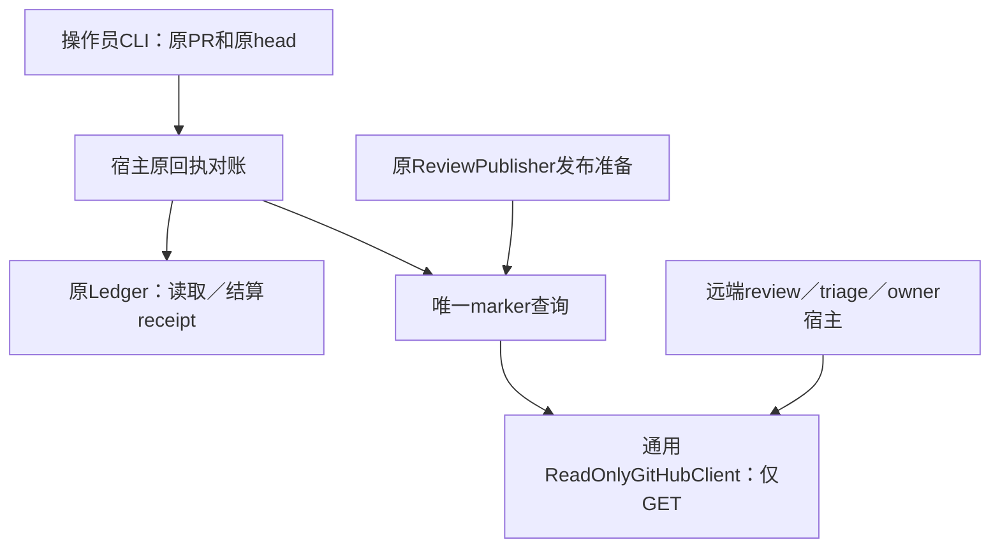

# 原发布回执的独立对账入口 · 2026-10-17

框架阶段保持收口。本次完成已复现的恢复连接：原review被GitHub接受但响应丢失，随后head漂移；新发布必须拒绝，但原回执仍应可独立结算。现在有宿主应用函数和实际CLI入口，不需要重算review或再次POST。

## 入口与边界

使用原实例配置和state directory，明确指定原reviewed head：

```bash
omni-reviewbot reconcile-review-publication --pr 5926 --head ORIGINAL_HEAD_SHA
```

该命令只读取GitHub，最多结算既有本地发布回执。它在provider runtime构建前处理，不读取当前PR head，不做knowledge重新判断，不恢复／重排jobs，不调用SDK review或模型，也不创建新发布。已有本地posted receipt不依赖远端再次可见；空读取和读取失败都保留pending；缺失／损坏的绑定不会被解释为“从未发布”。

返回码0表示原发布已确认；2表示pending／missing／明确rejected，没有新派发；1表示原账本不可用或损坏。账本以既有文件mode=rw打开，不迁移schema、不恢复运行中jobs，不创建缺失目录／DB。读取后DB丢失也会拒绝结算，不能悄悄创建替代账本。该入口不解决provider native unknown，不重写原业务任务的stale状态。



## 唯一owner与调用方迁移

| 能力 | 唯一owner／调用方 | 旧主体处理 |
| --- | --- | --- |
| marker查询 | Bot publication.publication_marker_present；publisher和原回执对账调用 | 删除publisher中的独立内联lookup主体，保留review／legacy issue-comment的同一正向证据政策；拒绝非bool成功值。 |
| 原effect对账 | Bot publication.reconcile_review_publication；commands.reviews及CLI进入 | 新接入原先缺失的操作入口，没有第二个review／发布循环。 |
| 只读GitHub transport | Bot github_client.ReadOnlyGitHubClient；remote_direct、remote_auxiliary、operator共用 | 删除remote_direct中的class主体；旧import路径保留同对象alias，不能独立调用栈。 |
| 原账本连接／receipt | Bot Ledger._connect及PublicationRepositoryMixin | 复用既有session／事务／receipt校验；增加must_exist选项，默认行为兼容，操作入口使用initialize=False／recover_running=False。 |

生产改动仅Bot七个src文件，净+63行／+492 AST节点；Copilot产品、schema及执行内核没有变化。只读class为迁移，不是新增第二个transport；原host拥有GitHub凭据和业务账本的边界保持不变。

## 代码与证据

完整双仓补丁、配对wheels与证据包 (host-local path: `/data/zhoutaichang/copilot/output/single-capability-completion-20261012/publication-original-reconciliation-20261017/publication-original-reconciliation-review.tar.gz`)分别相对Copilot647e6e02／ReviewBot1e70e983应用一次，不叠加旧overlay；包含此前保留工作。没有commit、push或部署。

当前Bot wheel SHA256为 `24ac7cfba06139988757ee192179ef77f59346066a9e2917ab6102250e84989a`，Copilot沿用 `1b36ed44ab9fc649ec364aa51c0747f25aeda4e9c07cf024366db721910309a9`。130个Bot产品成员与wheel、安装和冻结源码逐字节匹配；依赖复用，不称fresh安装。

验证记录 (host-local path: `/data/zhoutaichang/copilot/output/single-capability-completion-20261012/publication-original-reconciliation-20261017/validation.json`)及原JUnit保留全部范围。当前源码定向和安装验证通过：负向／不可用／畸形marker、已知receipt离线复用、缺失／损坏绑定、并发结算、既有review id不可覆盖、URI路径、DB在读取后丢失、jobs状态不变、CLI不bootstrap模型、只读transport的单一owner。安装验证以-I从源码目录外运行，清除PYTHONPATH／PYTHONHOME，pip check通过。

实际安装CLI通过loopback HTTP服务验证：负读取保持pending；正向原marker结算posted；服务关闭后复用本地receipt；缺失state拒绝且不创建目录。只有三次HTTP GET，无POST和当前head读取，原job仍为stale；配置不存在的provider命令也能正常对账。实际console-script入口也通过。另用同一已安装publisher复现“已接受／丢响应→head漂移→stale”，再调用新对账入口，receipt变posted且总effect仍为一次。模型／GitHub由受控适配器或本机HTTP服务提供，没有真实模型或GitHub写入。

当前完整Bot源码套件2925项通过，无失败／错误／skip；安装验证235项通过。原监督进程成功退出（returncode0、reason null），JUnit、spec／日志hash及326份冻结输入／当前工作树文件匹配，最终树为841e653effff0ddbdde4aa47fe9d9804e6dfa053。结果绑定validation.json及post-suite-proof.json，不借用旧版本完整套件。修复前缺少入口的失败及前次原工作流pending证据保留，不伪造历史成功。

## 保留的完整目标

本次只关闭原effect回执的已复现连接，不将其等同全部深层恢复、真实远端一致性或上线验收。原519分配、未用额度、原native unknown和历史失败继续保留；真实质量／独立标签、其余后端、最终release／pins和在途保留／rollout仍按[完整计划](single-capability-completion-plan.md)推进。框架不重开，完整目标尚未完成。
