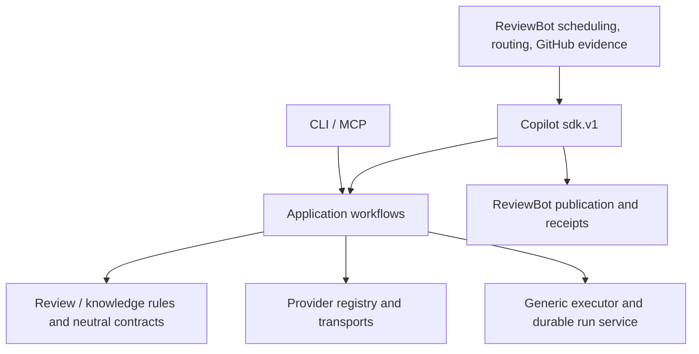

# Copilot / ReviewBot capability ownership

Current framework ownership and migrated callers are recorded in the
[framework delivery](single-capability-framework-delivery.md) and exact
[inventory](single-capability-framework-inventory.json). The original
[completion plan](single-capability-completion-plan.md) retains the remaining
quality, recovery and release gates. Framework conformance is distinct from
final acceptance.

This migration keeps two distributions. Copilot executes reviews and knowledge
workflows. ReviewBot owns GitHub business state and delivery. The baseline is
Copilot `647e6e02b083e61801e1bccd20c30a1aa7f590ec` and ReviewBot
`1e70e98310f191dc7ea77ffa508eaa0093e5b0c6`.

## Dependency direction



`contracts.models` owns DTO definitions; SDK exports preserve class identity and
old serialization. Internal modules do not import SDK modules. The generic
executor receives application-injected execution policies; self-improvement
budgeting lives in `improve.execution`. Bot provider calls cross `sdk.v1` only.

## Capability inventory and cutover

Paths below are relative to each package's `src` directory unless specified.
Compatibility modules translate inputs or re-export definitions; they do not
retain independent generation, repair, or validation loops.

| Capability | Canonical implementation in Copilot | Callers / removed implementation |
| --- | --- | --- |
| Provider identity and capabilities | `providers.registry`, `providers.descriptors` | Bot config, routing, readiness and worker limits query SDK descriptors instead of copying backend facts. |
| Model invocation and process lifecycle | `providers` adapters, `providers.json_session`, `providers.completion` | Bot Codex/Cursor runner files retain configuration compatibility only; triage, owner routing and knowledge use public restricted completion. Bot vendor command/event implementations are removed. |
| Structured output extraction | `structured_output` | LLM parsing, knowledge model parsing and JSON sessions delegate with explicit compatibility policies. |
| Model-call accounting | `budgeting`, provider invocation hooks | Knowledge and improvement retain separate quota policy/journals; shared call accounting records actual spend and unknown usage. |
| Durable review execution | `app.run_service`, `engine.steps.review.direct_run`, existing Strict workflow | `ReviewRuntime` submits both modes. Bot pipeline no longer performs Direct generation or repair. Local and remote workers submit the same provider request. |
| Direct prompt/schema and result checks | `review.direct_prompt`, `review.schemas`, `review.review_result` | Bot prompt/schema/parser copies removed. SDK compatibility exports delegate. |
| Finding rechecks and completion | `review.rechecks`, `review.direct` | Bot and runtime consume the same checks; old SDK module names delegate. |
| Diff interpretation | `review.diff` | Strict anchor shim, bot publication projection and finding contexts consume the same diff index, including incomplete hunk status. |
| Publication eligibility | `review.publication_policy` | Bot publication and standalone PR publication use the same head rule; feedback reconciliation uses the shared alignment check. GitHub reads/writes remain host-owned. |
| Knowledge constraints and rule parsing | `knowledge_service.format` | Curation, lifecycle, catalog and validator copies removed. |
| Workspace / snapshot validation | `knowledge_service.validation`, `knowledge_service.validators` | Apply/init/reconcile share ordered validator execution. `knowledge/tools/check_knowledge_tree.py` and `check_wiki_lint.py` are thin CLI wrappers. Packaged wheels carry the same implementations and schema. |
| Knowledge curation | `knowledge_service.curation`, `knowledge_service.drafting` | `KnowledgeCurator.curate` owns bounded generation/repair/validation/application. Bot `knowledge_model.py` and `knowledge_curation_cycle.py` deleted. |
| Evidence identity and normalization | `knowledge_service.evidence` | Bot intake/evidence and Copilot mailbox/PR sources delegate parsing, repository identity, path normalization and bounded diff excerpts. |
| Git snapshot object reads | `git_objects` | Knowledge sources/init share object/tree access. |

## Compatibility and persistence

- `StrictRuntime` aliases `ReviewRuntime`; existing Strict and Direct planning APIs
  remain available. Review results retain mode-specific evidence and diagnostics.
- `supports_durable_direct_execution` and `durable_review_api_version=1.0.0`
  identify the paired runtime contract. A missing capability fails before dispatch
  even when an older distribution uses the same package version.
- Direct reservation binds the business key, repository/head, frozen business
  input, knowledge revision and deployment-owned provider profile. The provider
  owns a durable checkout independent of the bot's temporary worktree.
  These Git snapshots consume provider run-directory storage and must remain
  available until the run is terminal and its result has been reconciled.
- Strict requests accept additive frozen business context, including discussion
  and CI evidence. Omitting it preserves the existing request wire shape. Bot
  recovery reloads its persisted evidence instead of collecting a different
  discussion or CI snapshot for the original request.
- `provider_run_id` is additive to bot state. Legacy `strict_run_id` remains an
  alias for Strict state. Old rows retain their meaning during schema migration.
- Bot jobs/publication receipts, provider runs, knowledge lifecycle and domain
  budget journals keep separate authority. A provider result does not settle a
  publication receipt.
- A lost transport response or polling timeout leaves the business attempt
  pending. Reconciliation uses its original request key and execution binding;
  it must not start a second paid run or silently select a fallback provider.
- Both publishers refuse missing or changed review heads. Standalone Copilot
  previously could downgrade a stale review to summary publication; this is the
  intentional behavior change.
- Knowledge v1 append rendering preserves existing bytes except its documented
  append/date edits. Lifecycle rendering separately maintains sources, footers,
  indexes and tombstones. Both use the same constraints and validation pipeline.
- Tree validation, wiki lint, lifecycle checks and semantic judgment remain
  distinct checks. Validator receipts retain the old command/output hashes and
  add a digest of the actual canonical implementation.

## Verification and release

Behavioral suites cover provider processes, durable identity/recovery, old wire
serialization, knowledge rollback and lifecycle, diff clipping, publication and
dependency direction. `test/test_capability_ownership.py` and ReviewBot's
`tests/test_provider_boundary.py` prevent SDK back-dependencies and bot vendor
invocation copies from returning.

Run paired installed-wheel checks from a provider development environment with
the `build` package installed:

```sh
python tools/verify_paired_wheels.py --bot-root /path/to/ReviewBot --output /tmp/paired-wheels
python tools/measure_knowledge_refactor.py --bot-root /path/to/ReviewBot --output /tmp/source-metrics.json
```

The wheel harness removes source-path injection, installs both distributions in
a fresh environment and checks child-process import provenance, SDK contracts,
packaged resources, local/remote Direct execution, and recovery. Its fake model
CLI produces deterministic results; these tests do not establish model quality.
Production lines and Python AST statements are reported against the frozen
baseline, including new files. A line-count reduction is not a release gate.

Before release, publish the provider revision and pin the paired consumer to its
immutable commit. ReviewBot PR CI can use `.ci/infermatrix-test.sha` to test an
unreleased pair while deployment continues using `deploy/infermatrix-release.sha`.
Do not replace the deployment pin with an unpublished or fabricated commit.
Validate provider capability negotiation before accepting work.

Run a frozen, representative model shadow evaluation before rollout. Keep its
quality/cost assessment separate from deterministic conformance. Drain in-flight
runs, or retain their original worker location, installed provider release,
profile and state directories through reconciliation. A new release must not
reinterpret an unknown old execution as permission to dispatch again.
Check the provider run ledger when draining: the existing closed/draft/superseded
PR policy can abandon a bot business attempt before its provider process ends.
An abandoned bot job is not a provider cancellation receipt; this migration does
not change that business cancellation policy.
