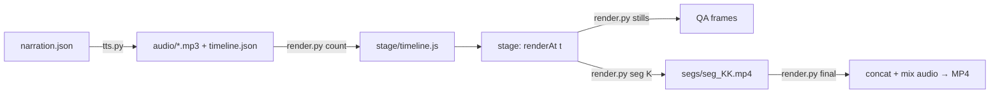

# Explainer video pipeline

The video is a deterministic web page. `renderAt(t)` draws the exact frame for time `t`, so the browser preview and the captured frames are identical. By default, the voiceover drives the timeline: each scene lasts as long as its narration needs, or its `min_len`, whichever is longer. For a strict duration limit, budget the scenes first and fit narration to that budget (see §3).



Templates live in `templates/` next to this file. Copy them into a new project directory; do not edit the templates for one project.

## 1. Story and facts first

1. Establish audience, length, and the scene list from the request. Set duration, branding and hardware scope per project; do not inherit those limits from a previous video. Sum scene durations before coding; if a suggested list exceeds the requested total, compress it while preserving the main story. Ask only for consequential missing choices. If the user authorizes unattended completion, continue through the final MP4; a storyboard approval gate applies only when requested and still in force.
2. Pull every number, status, and name from a primary source (repo, PR, report). Write the source next to the line in the plan.
3. Label weak evidence on screen. Examples from the first use: a single-seed result shown with `accepted = false`; a PR that is still Open described as "integration in progress", not "integrated".
4. Re-check dynamic status (PR state, CI) right before the final render.
5. For measured comparisons, bind each number to its hardware, revisions, configuration and timing scope. Keep same-configuration gains separate from additional configuration gains. Use actual result media when available; label reference imagery and data-driven replays. For pixel-identity claims, compare decoded source images, not resized thumbnails or video frames. Show iteration order without inventing a performance curve; preserve rejected, superseded and probe-only outcomes.

### Storyboard and shot preferences

- For technical demos, prefer a concrete task connecting a brief mechanism explanation, visible execution, measured results, and review or reuse where relevant. Reserve enough time for the results to be understood.
- Bridge mechanism and practice with task entry, submission and the start of exploration. Keep useful search-space layers visible; express exploration through actions instead of opaque experiment IDs. For parallel-agent demos, show one shared task branching into complementary subtasks and returning candidates for unified validation. Keep the task, model, hardware and quality constraints consistent across adjacent scenes.
- Give terminal demonstrations a dedicated, readable area matching the target CLI. Use available real sessions to ground prompts, commands and outputs while keeping them relevant to the current task. Keep replay attribution unobtrusive.
- Keep before/after positions consistent. Separate hardware or PR cases into shots when their metrics or quality evidence would otherwise be ambiguous; keep each result attached to its own case.
- Prefer varied subjects. Distinguish subject diversity from seed variation, and avoid repeating the same image across consecutive shots. With enough matched outputs, use a readable paired montage followed by a brief overview. Identify missing matched outputs when planning additional generation.
- Coordinate generation, completion and narration. Preserve measured timing in replays and label slow motion; use additional evidence or result changes during longer narration. Narrate actions and conclusions, with subject names, seeds and detailed conditions in screen labels.

## 2. Set up the project

Resolve `<skill-dir>` to the directory containing this `SKILL.md`, whether installed by a plugin or copied into a host's skill directory. Copy its templates into a new project directory.

macOS / Linux:

```bash
cp -R "<skill-dir>/templates" "<project-dir>"
python3 -m venv "<project-dir>/.venv"
"<project-dir>/.venv/bin/python" -m pip install "edge-tts==7.3.1" playwright
"<project-dir>/.venv/bin/python" -m playwright install chromium
```

Windows PowerShell:

```powershell
Copy-Item -LiteralPath "<skill-dir>/templates" -Destination "<project-dir>" -Recurse
py -3 -m venv "<project-dir>/.venv"
& "<project-dir>/.venv/Scripts/python.exe" -m pip install "edge-tts==7.3.1" playwright
& "<project-dir>/.venv/Scripts/python.exe" -m playwright install chromium
```

Run the remaining commands from the project directory, using that environment's interpreter wherever `python` is shown. These dependencies are needed only for video generation. The pinned edge-tts version was verified with the service's v2 handshake; investigate compatibility before changing it.

Requires `ffmpeg` and `ffprobe` on PATH.

- For a revision, inspect the existing JS, active script imports, timeline and assets before copying; unreferenced scene files may contain unfinished edits. Work in a new directory and preserve the source. Reuse an existing working environment rather than creating another venv or reinstalling dependencies; the setup commands above are for a missing environment. Prove one real frame and a short encoded sample before a full render. Keep the new project's assets local where practical so it does not depend on mutable sibling-project paths.

- `narration.json`: `voice`, `rate`, `output`, and `scenes[]` with unique `id`, `min_len`, and `lines[]` of `{say, cap}`. Duplicate IDs stop TTS before any audio cache is written. `say` is spoken text (write numbers and English the way they should sound); `cap` is the on-screen caption.
- `stage/scenes/<id>.js`: one file per scene, registered with `scene(id, build, render, tint)`. `render` receives scene-local `t`; `meta.lines[i].start` gives absolute narration cue times. Add each file to `stage/index.html` before `boot.js`.
- `stage/core.js`: helpers `span`, `ease`, `enter`, `typeHTML`, `countTo`, `el`, `place`, `rand`. Only use time `t` for motion; never `Date.now()`, `Math.random()`, or CSS transitions, or capture will not match preview.
- Voices: list with `edge-tts --list-voices`. Pick the voice in the narration language; captions and voice must use the same language.
- Music (optional): set `music` to an mp3 path relative to the project and `music_lufs` to the bed loudness (default `-30`). `final` measures the track, applies the gain needed to reach `music_lufs`, fades it in over 2 s and out over 3 s, and ducks it about 10 dB under the voice with `sidechaincompress`. Leave `music` empty for voice only.
  - Use royalty-free tracks whose license allows commercial use without attribution, for example Mixkit (`https://assets.mixkit.co/music/<id>/<id>.mp3`). Record the track id and license in the report.
  - Pick a track at least as long as the video; the mix trims it, it does not loop. Ambient or minimal electronic tracks without vocals sit best under narration.
  - Source loudness varies widely: on the first use, four tracks needed gains from -16.9 to -22.7 dB to reach the same bed level. Set the level with `music_lufs`, not a fixed gain. Around `-30` the voice stays clear; preview 10 s before the full mix.

## 3. Voice and timeline

```bash
python tts.py .
python render.py . count
```

- Writes `build/audio/<scene>_<i>.mp3` and `build/timeline.json`, and prints each scene's start and length.
- After each TTS run, `render.py . count` exports the current timeline and configured FPS to `stage/timeline.js` for browser preview, and prints the segment count. Run both commands again after narration or timing changes.
- Existing MP3 files are reused only when their adjacent JSON metadata matches `say`, `voice` and `rate`. Changing any of these, or using an older cache without metadata, regenerates that line. Caption-only edits reuse the audio.
- For a strict total, shorten narration first, then use modest `atempo` adjustment only if speech stays clear. Measure the fitted audio with `ffprobe`, retain lead/tail space, and require every line to end within its scene. The supplied `tts.py` uses narration-driven lengths; fixed-budget timing needs a project-local adaptation, not just smaller `min_len` values. Update audio cues, captions and JS animation timings together.
- When adding, reordering or lengthening shots, update the full timeline, transitions, captions and narration cues, then remix continuous music and ducking against the new cues. Deliver the complete revised video when requested.
- edge-tts is an online service. The template bounds each synthesis attempt to 45 s and makes at most three attempts for missing audio, connection errors or timeouts, with backoff and a pause between lines. Other errors, including rejected handshakes, propagate without an application-level retry.
- The template writes `.part.mp3`, requires complete FFmpeg decoding before renaming it to the final MP3, and removes partial output on failure or cancellation. Reused audio is also decoded; an invalid cache stops the run so it can be removed and regenerated.
- `WSServerHandshakeError: 403` is a rejected handshake, not a rate limit; it does not alone prove a client-version problem. Check the installed client against current upstream releases before retrying. The 2026-10 v2 handshake change requires edge-tts 7.3.0 or later; 7.3.1 also fixes locale-dependent server-date parsing. After an authorized dependency fix, verify real new speech and decode it before declaring recovery. Bound online calls with a timeout; do not loop retries on 403 or upgrade unrelated dependencies. Invalidate partial audio from a failed call.

## 4. Preview and QA before the full render

1. After both commands in §3, open `stage/index.html` in a browser for live playback, or `index.html?t=12.5` to freeze one moment. A short animated preview can establish composition and motion for a substantial structural change; apply only the approval gate established in §1.
2. Capture stills at the busiest moments of each scene:
   `python render.py . stills 3.2 12.5 24 ...` → `build/still_*.png`.
3. Read every still. Check, in this order: caption overlapping content, text cut off or wrapped badly, elements crossing each other (lines through numbers, labels on nodes), and wrong facts.
4. Fix and re-capture only the affected times. A full render is the most expensive step; do not use it to find layout bugs.
5. Before capturing, await `document.fonts.ready` and image decoding. Check both columns and the reserved caption/footer area; a theme change must also update scene-local hardcoded colors. An iteration overview and a results thumbnail strip can share a scene when that preserves readability. For embedded video, setting `currentTime` alone is insufficient: await the seek before capture, or recreate the replay deterministically from source images and measured timings. Save a contact sheet when useful for review.

## 5. Render in segments

```bash
python render.py . count          # number of segments
python render.py . seg 0          # repeat for each remaining segment; stop on failure
python render.py . final
```

- Each segment is `SEG = 300` frames rendered by its own browser and encoder, so memory is released between segments. A full single-pass render of ~1900 frames ran out of memory on the first use.
- A segment is written as `.part.mp4` and replaced only on success, then receives a `.sha256` sidecar recording its render inputs. Re-running skips a segment only when that signature matches the full timeline, stage files, renderer and capture/encode settings. Keep render assets under `stage/` so they are included in the signature. Changes conservatively invalidate all segments; older segments without signatures are regenerated. `final` rejects stale or unverified segments instead of mixing them with current narration. Keep inputs unchanged during each render command; delete a `.part.mp4` left by a crash.
- Check the exit code before proceeding to the next segment. If piping logs through `tail` in Bash, use `pipefail` so an encoder failure is not hidden.
- Defaults: capture at `scale = 1.0` (1280×720), ffmpeg lanczos upscale to 1920×1080, `-preset medium -crf 17`. On the first use this cut a segment from ~37 min (1.5× capture, `slow`) to ~4 min with no visible difference. Raise `scale` only when the machine is idle and small text looks soft.
- Set `FPS` in `render.py` for a different frame rate; capture, encoding and the page's HUD timecode use that value, injected as `window.TL.fps`.
- All segments must share codec, resolution, pixel format, fps, and time base, because `final` joins them with stream copy. Changing render settings invalidates the saved segments; re-run all segment commands before `final`.
- Long renders: run one segment per command, or in the background with a bounded log, and report progress. If the machine becomes unresponsive, stop task-owned heavy work and reduce capture scale or encoder load before continuing; ask for help only if the available resources still block completion.

## 6. Verify the output

```bash
ffprobe -v error -show_entries format=duration:stream=codec_type,width,height,nb_frames,duration -of compact <out.mp4>
ffmpeg -v error -i <out.mp4> -f null -
ffmpeg -v error -i <out.mp4> -vf "select='eq(n\,299)+eq(n\,300)+eq(n\,599)+eq(n\,600)',scale=480:-1,tile=4x1" -frames:v 1 seams.jpg
```

- Video frame count must equal `int(total * fps)`; audio duration must match video within one AAC frame (~0.03 s).
- Require the requested duration, resolution and frame rate, an audible audio track without clipping, and complete error-free decoding. Check an extracted final frame, not only browser stills. Audio cue checks establish scene bounds; they do not replace listening for speech quality or exact synchronization.
- Read the seam sheet: frames on both sides of each segment boundary must be continuous, with the caption matching the scene.
- Tell the user what you could not check, such as exact voice-to-animation timing, which needs a full playback.

## 7. Finish

- Delete temporary sample/silent videos and unused QA artifacts; retain a useful storyboard/contact sheet, editable JS, narration, source references and concise validation results. Keep `build/segs/` only while more edits are expected, including the signature sidecars needed for resuming an unchanged render. Close task-owned browsers and processes.
- Report: output path, duration, size, checks run, checks not run, and that nothing was published or committed.
